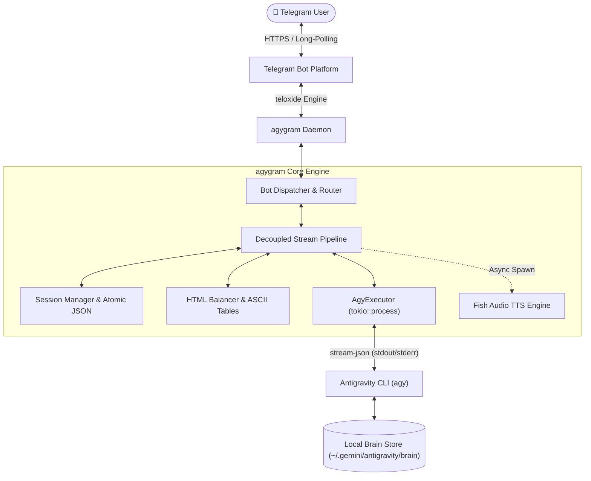

<div align="center">

# 🚀 agygram

**Turn your Telegram into a high-performance command center for Google Antigravity CLI.**

[](https://www.rust-lang.org)
[](https://github.com/d3intran/agygram)
[](LICENSE)
[](#)

[English](README.md) • [简体中文](README_ZH.md)

<br/>

```
┌─────────────────────────────────────────────────────────────┐
│ Telegram App               agygram Daemon                   │
│                                                             │
│ 🧑 User: "Refactor API" ──> ⚡ Ingest Event Queue (0µs lag)  │
│                             │                               │
│ 🤖 agy: <i>Thinking...</i>  <── ✍️ Ticker Draft (1000ms)    │
│ 🤖 agy: <code>code...</code>    ├── 🧠 Brain Continuity (~/brain)│
│ 🖼️ [Image.png pushed]    <── ├── 📦 Asset Auto-Delivery     │
│ 🎙️ [Shenhe Voice Voice] <── └── 🔊 Fish Audio TTS (Parallel)│
└─────────────────────────────────────────────────────────────┘
```

</div>

---

## 💡 Why agygram?

**Google Antigravity CLI (`agy`)** is one of the most capable agentic coding CLIs available. However, developers often work across devices—on mobile while commuting, checking server deployments from a laptop, or wanting quick task triggers without keeping an SSH terminal open.

**agygram** solves this by providing a zero-latency, enterprise-grade Telegram daemon tailored specifically for `agy`:

* **No Terminal Bottlenecks**: Decoupled two-task concurrency model ingests CLI stdout in memory with zero backpressure, keeping CLI execution at full native speed.
* **No Telegram Entity Errors**: Built-in incremental streaming HTML tag balancer auto-completes `<pre>`, `<code>`, and `<blockquote>` tags during mid-turn live generation.
* **Deep Local Brain Continuity**: Directly inspects `~/.gemini/antigravity/brain/` to let you resume active sessions (`/history`), view architecture plans (`/plan`), and inspect execution reports (`/walkthrough`) with single-tap inline buttons.
* **In-Place UI Controls**: Manage models, thinking effort, and execution modes via in-place message updates—no annoying message spam.
* **Automatic File & Asset Delivery**: Generated mockups, charts (`.png`), PDFs, or JSON data files are automatically detected and pushed to your Telegram chat.

---

## ✨ Features at a Glance

| Feature | Description |
| :--- | :--- |
| ⚡ **True Typewriter Streaming** | Real-time `stream-json` event parsing with memory ingestion and adaptive 429 rate-limiting backoff. |
| 🧠 **Local Brain Integration** | View `/history` with one-tap resumption, inspect `/plan` and `/walkthrough` artifacts directly. |
| 🎛️ **In-Place Control Panel** | `/status` provides a unified interactive card for model, effort, mode, and voice controls with back navigation. |
| 📊 **Monospace ASCII Tables** | Converts Markdown tables into mobile-friendly ASCII box `<pre><code>` blocks that never wrap awkwardly on phones. |
| 🖼️ **Artifact Auto-Delivery** | Auto-detects generated images (`.png`/`.jpg`) and documents (`.pdf`/`.json`/`.csv`) **inside the bound workspace** and sends them as native attachments; paths outside it are never uploaded. |
| 🤖 **Top-Tier Model Matrix** | Seamlessly switch between `Gemini 3.8 Flash` (High/Med/Low), `Claude Sonnet 4.6`, `Claude Opus 4.6`, and `GPT-OSS 120B`. |
| 🔊 **Shenhe TTS Voice Engine** | Asynchronous parallel speech generation powered by Fish Audio with character voice modeling. |
| 🛑 **Graceful Process Interruption** | New messages gracefully cancel in-flight tasks (`SIGINT` first to preserve Brain logs, then `SIGKILL`). |
| 🛡️ **Hardened Security** | Strict numeric User ID whitelist and atomic JSON session persistence with crash resilience. |

---

## 🏗️ Architecture



---

## 🚀 Quick Start in 60 Seconds

### Step 1: Prerequisites
- Ensure **Google Antigravity CLI (`agy`)** is installed and running (`agy --version`).
- Install Rust toolchain (if compiling from source):
  ```bash
  curl --proto '=https' --tlsv1.2 -sSf https://sh.rustup.rs | sh
  ```

### Step 2: Clone & Build
```bash
git clone https://github.com/d3intran/agygram.git
cd agygram
cargo build --release
```
The optimized release binary is located at `target/release/agygram` (~5.6MB with Fat LTO and symbol stripping).

### Step 3: Interactive Configuration Wizard
Run the interactive onboarding wizard to configure your bot token, allowed user IDs, and workspace in seconds:
```bash
./target/release/agygram init
```
*(Alternatively, copy `config.example.toml` manually to `~/.config/agygram/config.toml`)*

### Step 4: Verify & Launch
```bash
# Verify configuration and CLI path
./target/release/agygram check

# Start daemon in foreground
./target/release/agygram daemon
```

---

## 🛠️ Production Deployment (Systemd Service)

To run `agygram` 24/7 in the background with auto-restart on system reboot:

1. **Create systemd unit file**:
   ```bash
   sudo nano /etc/systemd/system/agygram.service
   ```

2. **Paste configuration** (replace `azureuser` and paths with your setup):
   ```ini
   [Unit]
   Description=agygram Telegram Bot Daemon Service
   After=network.target network-online.target
   Wants=network-online.target

   [Service]
   Type=simple
   User=azureuser
   WorkingDirectory=/home/azureuser
   ExecStart=/home/azureuser/agygram daemon
   Restart=always
   RestartSec=5s
   Environment=PATH=/usr/local/bin:/usr/bin:/bin:/home/azureuser/.local/bin:/home/azureuser/.cargo/bin
   Environment=HOME=/home/azureuser

   [Install]
   WantedBy=multi-user.target
   ```

3. **Enable and start**:
   ```bash
   sudo systemctl daemon-reload
   sudo systemctl enable agygram
   sudo systemctl start agygram
   sudo systemctl status agygram
   ```

---

## 📋 Command Reference

### 🔄 Session & Control
| Command | Description | Example |
| :--- | :--- | :--- |
| `/status` | Open multi-level in-place interactive control dashboard | `/status` |
| `/new` / `/reset` / `/clear` | Reset conversation context and start fresh | `/new` |
| `/resume [<ID>]` | Resume past session (empty arg continues latest context) | `/resume` or `/resume 8de907d6` |
| `/cancel` | Gracefully terminate active `agy` task and release lock | `/cancel` |
| `/usage` / `/quota` | View Antigravity CLI Token usage and telemetry dashboard | `/quota` |

### 🧠 Antigravity Brain & Ecosystem
| Command | Description | Example |
| :--- | :--- | :--- |
| `/history` | List active VPS history sessions with one-click resume buttons | `/history` |
| `/plan` | View current session's architecture plan (`implementation_plan.md`) | `/plan` |
| `/walkthrough` | View current session's validation report (`walkthrough.md`) | `/walkthrough` |
| `/skills` | Inspect active Antigravity Skills library | `/skills` |
| `/rules` | View active global and workspace rules | `/rules` |
| `/mcp` | View configured Model Context Protocol (MCP) servers | `/mcp` |
| `/plugins` | View installed agy plugins | `/plugins` |
| `/changelog` | View agy CLI latest changelog | `/changelog` |

### 📂 Workspace & Files
| Command | Description | Example |
| :--- | :--- | :--- |
| `/cd <path>` | Switch primary workspace directory (supports `~/...`) | `/cd ~/projects/my-app` |
| `/adddir <path>` | Add auxiliary workspace directory (`--add-dir`) | `/adddir ~/libs/shared` |
| `/cleardirs` | Clear all attached auxiliary directories | `/cleardirs` |
| `/dirs` / `/pwd` | View all currently bound workspace directories | `/pwd` |
| `/file <path>` | Transmit any VPS file directly to Telegram | `/file ~/.config/agygram/config.toml` |

### 🤖 Model & Voice Settings
| Command | Description | Example |
| :--- | :--- | :--- |
| `/model [<name>]` | Switch AI model (supports aliases: `3.8`, `sonnet`, `opus`, `oss`) | `/model 3.8` |
| `/models` | List all supported AI models | `/models` |
| `/effort [<level>]` | Set thinking effort level (`low`, `medium`, `high`, `xhigh`, `max`) | `/effort high` |
| `/mode [<mode>]` | Switch execution mode (`accept-edits`, `plan`) | `/mode accept-edits` |
| `/agent [<name>]` | Switch active Agent identity | `/agent code-reviewer` |
| `/agents` | List all available system Agents | `/agents` |
| `/system [<prompt>]`| View, set, or clear custom System Prompt | `/system Respond in English` |
| `/voice [on\|off\|toggle\|<text>]` | Control Shenhe voice replies or submit one-shot voice query | `/voice on` or `/voice introduce yourself` |

---

## ❓ FAQ & Troubleshooting

<details>
<summary><b>Q1: "Permission Denied: User ID not allowed"?</b></summary>
Telegram enforces a strict numeric user ID whitelist for server security. Open Telegram and search for <code>@userinfobot</code> to retrieve your ID, then add it to <code>allowed_user_ids = [YOUR_ID]</code> in <code>~/.config/agygram/config.toml</code> and restart the daemon. An empty whitelist now denies every request; serving arbitrary users requires the explicit <code>allow_all_users = true</code> opt-in, which is risky because the daemon runs <code>agy</code> with <code>--dangerously-skip-permissions</code>.
</details>

<details>
<summary><b>Q2: "Failed to find agy CLI binary"?</b></summary>
Ensure <code>agy</code> is installed in a standard PATH directory such as <code>~/.local/bin/agy</code> or <code>/usr/local/bin/agy</code>. Verify with <code>which agy</code> or <code>agy --version</code>. If using systemd, ensure <code>Environment=PATH=...</code> in the unit file contains the agy directory.
</details>

<details>
<summary><b>Q3: How to connect via proxy?</b></summary>
Uncomment <code>proxy_url</code> in <code>~/.config/agygram/config.toml</code> and specify your proxy endpoint, e.g., <code>proxy_url = "socks5://127.0.0.1:1080"</code> or <code>proxy_url = "http://127.0.0.1:7890"</code>.
</details>

---

## 📜 License

This project is open-sourced under the **MIT License**. Compliant with Google Antigravity CLI native specifications and high-performance Rust best practices.
