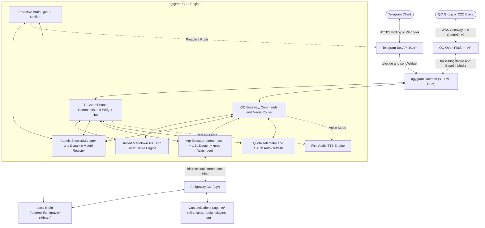

<div align="center">

# 🚀 agygram

**An ultra-lightweight Rust 2024 daemon (<10 MB RAM) turning Telegram & QQ into a 24/7 mobile command center for Google Antigravity CLI (`agy`).**

[](https://github.com/d3intran/agygram/actions/workflows/release.yml)
[](https://github.com/d3intran/agygram/releases)
[-orange.svg?style=flat-square&logo=rust)](https://www.rust-lang.org)
[](#)
[](#)
[](#)
[](#)
[](https://opensource.org/licenses/MIT)

[English](README.md) • [简体中文](README_ZH.md) • [Changelog](CHANGELOG.md)

</div>

---

## 💡 Why agygram?

Running autonomous AI coding agents on cloud servers usually comes with two major bottlenecks: **high API bills** and **bloated Node.js / Docker runtimes** that trigger OOM crashes on 512 MB–1 GB micro-VPS instances.

**Google Antigravity CLI (`agy`)** unlocks frontier models (**Gemini 4 Hydrogen / Carbon / Argon**, **Gemini 3.8 Flash**, **Orchestrator**, **Claude Opus/Sonnet 4.6**, **GPT-OSS 120B**) alongside `.agents/` skills, rules, hooks, plugins, and MCP servers. **`agygram`** wraps `agy` in a native, zero-bloat Rust daemon:

- 🪶 **Micro-VPS Native (<10 MB Idle RAM)**: Compiled with Fat LTO into a ~10 MB binary. Runs 24/7 alongside `agy` on 1 vCPU / <1 GB RAM cloud servers with zero Docker or Node.js daemon overhead.
- ⚡ **1.5s `stream-json` Background-Task Detach**: Streams `agy --output-format stream-json` line-by-line. When `agent_response` finishes (`state: DONE`) with no active tool calls while background subagents or `schedule` timers keep running, `agygram` waits a 1.5s grace window, delivers your reply immediately, releases the chat lock, and pushes follow-up turns asynchronously—never deadlocking on `child.wait()`.
- 🌐 **Dual-Stack Telegram + QQ Gateway**: Run Telegram (`teloxide` Long-Polling or Axum Webhook) and Tencent QQ Official Bot (`wss` WebSocket Gateway + OpenAPI v2 REST) concurrently in one process with unified session & workspace management.
- 📐 **Unified Markdown AST & Smart Responsive Tables**: Powered by `pulldown-cmark` + `unicode-width`. Compact CJK tables (`<= 38` display columns) render as crisp East-Asian-width-aligned Unicode box tables (`┌─┬─┐`), while wider or multi-line tables automatically switch to mobile-friendly vertical card layouts on both Telegram and QQ.
- 🎛️ **Multi-Page Telegram Control Panel & Live Model Sync**: `/panel` (`/settings`, `/status`) provides an in-place InlineKeyboard dashboard with two-stage family/variant pickers, live `agy models` + `/quota` synchronization, and strictly `<= 64`-byte callback tokens.
- 🎮 **Telegram Bot API 10.4+ QuickJS Widgets & Offline Mini-Games**: `/card` (`/widget`) launches 4 built-in offline QuickJS mini-games (**2048**, **Minesweeper**, **Memory Match**, **Reaction Tap**) plus AI-generated interactive cards (`tg-card`) and custom offline apps (`tg-widget`) with automatic `.html` WebView fallback.
- 📦 **QQ Base64 Direct Media & Smart Group File Handling**: Uploads local images, MP4 videos, voice clips, and files (`<= 5 MB`) directly via OpenAPI v2 `file_data` Base64 without needing an external file server, with intelligent inline preview fallback when files exceed QQ limits or API rules restrict them.
- 🔊 **Fish Audio Voice Replies**: Optional parallel speech synthesis (`opus`/`mp3`) with per-session voice IDs (`/voice id`), QQ emotion cues, and table/code-aware speech cleaning.

---

## 📱 Telegram Control Panel & QuickJS Preview

```text
┌──────────────────────────────────────────────┐  ┌──────────────────────────────────────────────┐
│ 🎛 agygram 控制中心 v1.6.0 · agy v1.5.10     │  │ 🎮 QuickJS 交互卡片 & 离线小游戏 (/card)     │
│                                              │  │                                              │
│ • 模型: Gemini 4 Hydrogen (XHigh)            │  │ • 私聊 <= 4KB (zlib-9): 原生 sendWidget 气泡  │
│ • 力度 / 模式: xhigh · accept-edits          │  │ • 群聊 / 超限: 自动降级为可玩 .html 附件/卡片  │
│ • 实时额度: Gemini 100% · Claude/GPT 95%     │  │ • AI 生成: /card 写一个五子棋 / 复利计算器     │
│ • 会话: 8de907d6 · 4 轮 (12k in / 3.4k out)  │  │                                              │
│                                              │  │ [ 🔢 2048 ]           [ 💣 扫雷 ]            │
│ [ 🤖 模型 · H2·XHigh ]  [ 📊 实时额度 ]      │  │ [ 🃏 记忆翻牌 ]       [ ⚡ 极速反应 ]        │
│ [ ⚡ 力度: xhigh ]      [ 🎯 模式: accept ]  │  │ [ 📊 运行看板卡 ]     [ ❓ QuickJS 速测 ]    │
│ [ 💬 会话管理 ]         [ 📂 工作区 & 角色 ] │  │ [ 📋 通道对比表 ]     [ 🃏 Agent 演示卡 ]    │
│ [ 🔇 输出/TTS (关) ]    [ 🔄 刷新面板 ]      │  │ [ 🩺 当前会话状态卡 ] [ « 返回控制中心 ]     │
│ [ 🩺 系统与生态 ]       [ 🆕 开启全新会话 ]  │  └──────────────────────────────────────────────┘
└──────────────────────────────────────────────┘
```

---

## ⚡ 30-Second Quick Start (Pre-Built Binary)

> [!TIP]
> **Do NOT compile Rust on micro-VPS instances (<1 GB RAM)**—Fat LTO builds require ~1.5 GB+ RAM and will OOM small servers. Download the pre-built binary built by GitHub Actions CI instead.

### 1. Prerequisite: Install & Authenticate `agy`
```bash
agy --version
agy models
```

### 2. Download Binary & Run Interactive Setup
```bash
# Download the latest release binary & verify SHA-256 checksum
bash <(curl -fsSL https://raw.githubusercontent.com/d3intran/agygram/main/update.sh)

# Run the interactive setup wizard (writes ~/.config/agygram/config.toml with 0600 permissions)
~/agygram init

# Verify config, whitelists, and agy CLI detection
~/agygram check
```
*(Or copy [`config.example.toml`](config.example.toml) to `~/.config/agygram/config.toml` and `chmod 600 ~/.config/agygram/config.toml`.)*

### 3. Run as a 24/7 Systemd Service
```bash
sudo tee /etc/systemd/system/agygram.service > /dev/null <<EOF
[Unit]
Description=agygram Telegram & QQ Bot Daemon
After=network.target network-online.target
Wants=network-online.target

[Service]
Type=simple
User=$(whoami)
WorkingDirectory=$HOME
ExecStart=$HOME/agygram daemon
Restart=always
RestartSec=5s
Environment=PATH=/usr/local/bin:/usr/bin:/bin:$HOME/.local/bin:$HOME/.cargo/bin
Environment=HOME=$HOME

[Install]
WantedBy=multi-user.target
EOF

sudo systemctl daemon-reload
sudo systemctl enable --now agygram
sudo systemctl status agygram --no-pager
```

### 🔄 One-Command Upgrade (or Version Pin)
```bash
# Upgrade to latest release (verifies SHA-256, keeps last 3 backups, restarts systemd)
bash <(curl -fsSL https://raw.githubusercontent.com/d3intran/agygram/main/update.sh)

# Optional: pin a specific release tag
AGYGRAM_VERSION=v1.6.2 bash <(curl -fsSL https://raw.githubusercontent.com/d3intran/agygram/main/update.sh)
```

---

## ✨ v1.6.x Feature Matrix

| Subsystem | Capabilities |
| :--- | :--- |
| 🧠 **Unified Markdown AST & Smart Tables** | `pulldown-cmark` + `unicode-width` AST pipeline shared across Telegram HTML & QQ Markdown/Plain-Text. Compact tables (`<= 38` display cols) render as CJK-aligned Unicode box tables; wide/multi-line tables automatically adapt into vertical cards. Tag- and fence-aware chunking closes/reopens `<pre>` / `<code>` / `<blockquote>` across splits and falls back to plain text on Telegram API parse errors. |
| 🎛️ **Telegram Multi-Page Control Panel** | `/panel` (`/settings`, `/status`) & `/session` with live `agy models` discovery, real-time `/quota` badges, two-stage family -> variant selection, smart `--effort` omission/clamping, workspace/agent/sandbox toggles, and deterministic `<= 64`-byte `callback_data` (`mh:`, `rh:`, `sh:`). |
| 🎮 **QuickJS Widgets & Offline Mini-Games** | Telegram Bot API 10.4+ `sendWidget` engine (`<= 32 KB` raw, `<= 4 KB` zlib-9 via `flate2`). Includes 4 built-in offline games (`2048`, `minesweeper`, `memory`, `reaction`), multi-template JSON `tg-card` schemas (`metric`, `quiz`, `table`, `status`), `/card <prompt>` AI generation, and automatic `.html` WebView or HTML card fallback. |
| 🐧 **QQ Official Bot Gateway & Media** | Concurrent Tencent Open Platform WebSocket gateway (`wss`) + OpenAPI v2 REST. Direct Base64 `file_data` upload (`file_type=1/2/3/4` up to 5 MB, verified working for QQ Group `.md` & document files), explicit-only `[[send_file:...]]` artifact delivery, `/file <path>`, numbered `/model <idx>`, `/compact`, and non-silent preview fallback when files exceed 5 MB or API limits. |
| ⚡ **1.5s Stream-JSON Detach & Watchdog** | Unbuffered `agy -p ... --output-format stream-json` pipe (`stdbuf -oL -eL`). Delivers Turn 1 after a 1.5s grace window if `agy` keeps running background subagents/timers, monitors `/proc` tree CPU/IO via `idle_timeout_secs` & `max_execution_secs`, and preserves conversation history on `/cancel`. |
| 🔔 **Proactive Brain Notifier & Ecosystem** | Watches `~/.gemini/antigravity-cli/brain` for `schedule` timer alerts and detached task completions. Exposes `/skills`, `/rules` (`GEMINI.md`, `AGENTS.md`, `.agents/rules/*.md`), `/mcp`, `/plugin`, `/plan`, `/walkthrough`, `/changelog`, and `/update`. |
| 🔊 **Fish Audio Voice Replies** | Optional parallel TTS (`s2.1-pro-free`) returning `opus` voice notes (TG) or media voice clips (QQ), per-session voice IDs (`/voice id`), emotion cues on QQ, and clean stripping of code blocks, tables, links, and HTML tags. |

---

## 🏗️ Architecture



---

## 🤖 Supported Antigravity Models & CLI Alignment

`agygram` ships with the current live `agy` model catalog and **automatically merges newly deployed models** at runtime via `agy models` (with a 120s cache TTL and `/quota` unmapped-model refresh):

| Family | Canonical Model IDs | Reasoning Effort (`--effort`) | Aliases |
| :--- | :--- | :--- | :--- |
| 💎 **Gemini 4 Hydrogen** | `gemini-4-hydrogen-{xhigh,high,medium,low}` | Embedded in variant | `h2`, `hydrogen`, `h2-xhigh` |
| 🔷 **Gemini 4 Carbon** | `gemini-4-carbon-{high,medium,low}` | CLI default (`low`/`medium`/`high`) | `carbon`, `carbon-high`, `default` |
| 🔹 **Gemini 4 Argon** | `gemini-4-argon-{high,medium,low}` | Embedded in variant | `argon`, `gemini-4`, `4-high` |
| ⚡ **Gemini 3.8 Flash** | `gemini-3.8-flash-{high,medium,low}` | Embedded in variant | `flash`, `3.8`, `3.8-high` |
| 🧠 **Orchestrator** | `gemini-pro-orchestrator`, `gemini-pro-orchestrator-argon` | Fixed by model | `orch`, `orch-argon` |
| 👑 **Claude 4.6** | `claude-opus-4-6-thinking`, `claude-sonnet-4-6` | Fixed by model | `opus`, `sonnet`, `claude` |
| 🌐 **GPT-OSS** | `gpt-oss-120b-medium` | Fixed by model | `oss`, `gpt`, `120b` |

> [!NOTE]
> `agygram` automatically omits `--effort` for models with fixed or suffix-embedded reasoning tiers (`claude-*`, `gemini-pro-orchestrator*`, `gpt-oss-*`, `*-{low,medium,high,xhigh}`), and clamps `xhigh`/`max` to `high` on the default `gemini-4-carbon` model so CLI invocations never error out.

---

## 📋 Command Reference

### 📱 Telegram Commands
| Category | Command | Description |
| :--- | :--- | :--- |
| **Control & Sessions** | `/panel`, `/settings`, `/status` | Open multi-page interactive Control Panel |
| | `/session` | Open Session Management Center (stats, recent switch, `/plan`, `/walkthrough`) |
| | `/new`, `/reset`, `/clear` | Start a fresh session and reset token/turn counters |
| | `/resume [<id>]` | Resume a session by ID or pick from recent sessions (`-c` fallback) |
| | `/history` | Browse recent VPS Brain conversations and tap to resume |
| | `/quota`, `/usage` | Query real-time Gemini & Claude/GPT quota bars and reset timers |
| | `/cancel` | Interrupt active task (`SIGINT` -> `SIGKILL` escalation) and release lock |
| **Widgets & Games** | `/card`, `/widget` | Open QuickJS Widget & Offline Mini-Game Hub (`2048`, `minesweeper`, `memory`, `reaction`) |
| | `/card <game\|demo\|html <target>\|<prompt>>` | Launch a game/card, export standalone `.html`, or ask AI to generate a custom widget/game |
| **Models & Policy** | `/model [<id\|idx\|alias>]` | Open model family picker or switch directly (supports dynamic models) |
| | `/models` | Sync with `agy models` and list all numbered models by family |
| | `/effort [<level>]` | Set reasoning effort (`low`, `medium`, `high`, `xhigh`, `max`) with sibling sync |
| | `/mode [<mode>]` | Switch execution mode (`accept-edits`, `auto`, `plan`) |
| | `/agent [<name>]`, `/agents` | Switch or list Antigravity subagents |
| | `/sandbox [on\|off\|toggle]` | Toggle `agy --sandbox` terminal isolation |
| | `/project [<name>\|clear]` | Bind or clear `agy --project` |
| | `/system [<prompt>\|clear]` | View, set, or clear custom System Prompt |
| | `/voice [on\|off\|toggle\|id <ref>\|<prompt>]` | Toggle Fish Audio TTS replies, switch voice ID, or ask a one-shot voice query |
| **Workspace & Ecosystem** | `/cd <path>`, `/pwd`, `/dirs` | Set primary workspace (`~/...` supported) or inspect bound dirs |
| | `/adddir <path>`, `/cleardirs` | Add or clear extra `--add-dir` project directories |
| | `/file <path>` | Download a VPS file (<= 50 MB) to Telegram |
| | `/plan`, `/walkthrough` | View current session's `implementation_plan.md` or `walkthrough.md` |
| | `/skills`, `/rules` | Inspect loaded skills and `GEMINI.md` / `AGENTS.md` / `.agents/rules/*.md` |
| | `/mcp [<subcmd>]`, `/plugin [<subcmd>]`, `/plugins` | Manage/list MCP servers and plugins via `agy mcp` / `agy plugin` |
| | `/changelog`, `/update` | View `agy changelog` or run `agy update` |

### 🐧 QQ Bot Commands (Group `@bot` & C2C DM)
- **Control & Sessions**: `/start`, `/help`, `/panel`, `/status`, `/new`, `/reset`, `/clear`, `/compact [<focus>]`, `/resume [<id>]`, `/history`, `/quota`, `/usage`, `/cancel`
- **Models & Execution**: `/models`, `/model [<index|id|alias|reset>]` (e.g. `/model 1`, `/model argon`), `/effort [<level>]`, `/mode [<mode>]`, `/agent [<name|reset>]`, `/agents`, `/sandbox [on|off|toggle]`, `/project [<name|clear>]`, `/system [<prompt>|clear]`
- **Workspace, Files & Ecosystem**: `/workspace [<path>]`, `/cd <path>`, `/pwd`, `/dirs`, `/adddir <path>`, `/cleardirs`, `/file <path>`, `/skills`, `/rules`, `/voice [on|off|toggle|id <ref>|<prompt>]`

### 💻 Host CLI (`agygram`)
```text
agygram daemon   # Start Telegram / QQ / Dual-Stack daemon (default when no subcommand given)
agygram init     # Interactive config wizard (creates ~/.config/agygram/config.toml with 0600 mode)
agygram config   # Display resolved config path and contents
agygram check    # Validate config, whitelists, agy CLI path, and built-in model catalog
agygram quota    # Query and print live Antigravity quota telemetry in terminal
```

---

## 🛠️ Building from Source (Developers & Compute Nodes)

<details>
<summary><b>Expand source build instructions (requires Rust 1.88+ / Edition 2024 and >= 1.5 GB RAM)</b></summary>

```bash
curl --proto '=https' --tlsv1.2 -sSf https://sh.rustup.rs | sh
git clone https://github.com/d3intran/agygram.git
cd agygram
cargo build --release
./run.sh --version
```
</details>

---

## ❓ Troubleshooting & FAQ

<details>
<summary><b>Q1: Why shouldn't I run <code>cargo build</code> on a 512 MB–1 GB micro-VPS, and how should I deploy updates?</b></summary>
<p><code>agygram</code> compiles with <code>lto = "fat"</code> and <code>codegen-units = 1</code> to keep the binary compact (~10 MB) and idle memory under 10 MB, which causes <code>rustc</code>/LLVM linking to peak above 1.5 GB RAM. On micro-VPS hosts, always push code to GitHub Actions (<code>.github/workflows/release.yml</code> runs <code>cargo fmt</code>, <code>clippy -D warnings</code>, <code>cargo test</code>, and builds the release binary) or compile on a beefier build node, then run <code>update.sh</code> on your VPS to verify SHA-256 checksums and restart cleanly.</p>
<p><b>Systemd note:</b> If you trigger updates from inside an active <code>agy</code> session spawned by <code>agygram</code>, make sure you understand your service's <code>KillMode</code>—restarting <code>agygram</code> under default <code>KillMode=control-group</code> stops child processes in the cgroup, whereas <code>KillMode=process</code> leaves detached child processes alive.</p>
</details>

<details>
<summary><b>Q2: Does QQ Bot support sending files to QQ Groups (<code>file_type=4</code>)?</b></summary>
<ul>
  <li><b>Historical vs. Current Official API:</b> Older QQ Bot OpenAPI v2 docs marked <code>file_type=4</code> (generic file) as unsupported ("暂未支持"), and <code>agygram</code> v1.5.x only routed images (<code>file_type=1</code>) and voice (<code>file_type=3</code>). Current Tencent OpenAPI v2 docs (<code>v1.50.0</code>) document <code>file_type=1</code> (Image), <code>2</code> (Video MP4), <code>3</code> (Voice), and <code>4</code> (File) for both <code>/v2/groups/{group_openid}/files</code> and <code>/v2/users/{user_openid}/files</code>, including direct Base64 <code>file_data</code> uploads (up to <b>5 MB decoded</b>—no public file server needed).</li>
  <li><b>Real-World Platform Limits:</b> Official QQ bots can still encounter strict per-bot/group permissions, format checks (error codes <code>850019</code>, <code>10000</code>, <code>40093002</code>), or passive reply quotas (Group: 5 min / max 5 replies; C2C: 60 min / max 4 replies; error <code>40034128</code>).</li>
  <li><b>How agygram v1.6+ handles it:</b> <code>agygram</code> uses explicit-only artifact delivery (only when you ask to send a file or emit <code>[[send_file:...]]</code> / <code>/file</code>), attempts direct Base64 upload (<code>file_type=1/2/3/4</code> for <code>&lt;= 5 MB</code> files—verified live for QQ Group <code>.md</code> documents) and retries proactively on <code>40034128</code>. If a file exceeds 5 MB or QQ rejects the upload, <code>agygram</code> <b>never fails silently</b>: text/code/Markdown/CSV/JSON files (<code>&lt;= 64 KB</code> or text extensions) are delivered as formatted inline preview chunks, and binary/oversized files output a clear diagnostic with the exact VPS file path.</li>
</ul>
</details>

<details>
<summary><b>Q3: How do Telegram QuickJS Widgets (<code>/card</code>) work when running in a group chat or older client?</b></summary>
<p>Telegram Bot API 10.4+ restricts <code>sendWidget</code> to <b>private chats</b> (<code>chat_id &gt; 0</code>) with raw HTML <code>&lt;= 32 KB</code> and zlib level-9 compressed payload <code>&lt;= 4,096 bytes</code>. When you run <code>/card 2048</code> or ask the AI to build an offline mini-game or card, <code>agygram</code> compresses and checks the payload with <code>flate2</code>. If the chat is a group, the payload exceeds 4 KB compressed, or Telegram rejects the widget call, <code>agygram</code> automatically falls back to sending a playable standalone <code>.html</code> attachment (for games/apps, runnable directly in Telegram's built-in WebView) or a richly formatted Telegram HTML summary card.</p>
</details>

<details>
<summary><b>Q4: Bot ignores my messages or says unauthorized?</b></summary>
<p>Because <code>agygram</code> invokes <code>agy</code> with <code>--dangerously-skip-permissions</code>, access is <b>fail-closed</b> by default. Add your numeric Telegram User ID (from <code>@userinfobot</code>) to <code>allowed_user_ids</code>, or your QQ OpenID / Group OpenID to <code>qq_allowed_openids</code> / <code>qq_allowed_groups</code> in <code>~/.config/agygram/config.toml</code>, then restart the service.</p>
</details>

<details>
<summary><b>Q5: How do I configure a proxy, Webhook mode, or Fish Audio voice replies?</b></summary>
<p>Edit <code>~/.config/agygram/config.toml</code> (see <a href="config.example.toml">config.example.toml</a>):</p>
<ul>
  <li><b>Proxy:</b> Set <code>proxy_url = "socks5://127.0.0.1:1080"</code> or <code>"http://127.0.0.1:7890"</code> (also falls back to <code>HTTPS_PROXY</code> / <code>HTTP_PROXY</code>).</li>
  <li><b>Webhook:</b> Set <code>webhook_url</code>, <code>webhook_port</code> (default <code>8443</code>), and <code>webhook_secret</code> to switch Telegram from Long-Polling to Axum Webhook mode.</li>
  <li><b>Fish Audio TTS:</b> Set <code>fish_api_key</code> and optional <code>fish_reference_id</code>, then toggle via <code>/voice on</code> or switch voices dynamically with <code>/voice id &lt;reference_id&gt;</code>.</li>
</ul>
</details>

---

## 📜 License

Released under the [MIT License](https://opensource.org/licenses/MIT).
