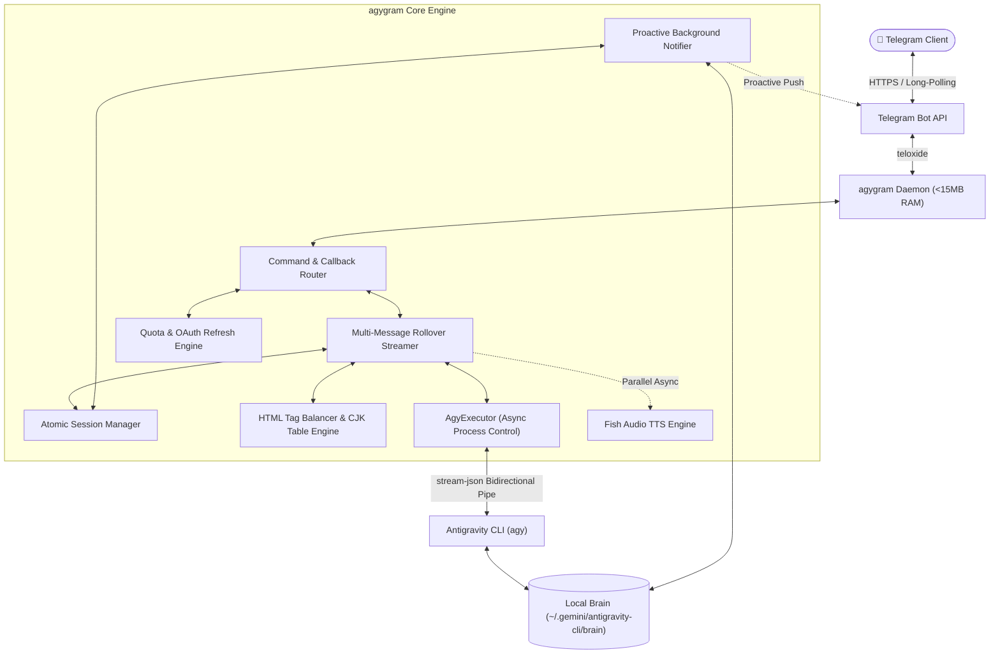

<div align="center">

# 🚀 agygram

**Turn Telegram into a 24/7 Ultra-Lightweight Mobile Command Center for Google Antigravity CLI (`agy`).**

[](https://github.com/d3intran/agygram/releases)
[](#)
[](#)
[](https://www.rust-lang.org)
[](LICENSE)
[](#)

[English](README.md) • [简体中文](README_ZH.md)

</div>

---

## 💡 Why agygram?

Running autonomous coding agents (like Claude Code, OpenClaw, or Cursor agents) on a cloud server typically comes with two major headaches: **expensive API bills** and **heavy resource usage** (Node.js/Docker setups easily crash 1GB RAM micro-VPS instances).

**Google Antigravity CLI (`agy`)** provides generous access to frontier models (**Gemini 4 Argon**, **Claude Opus 5.5**, **Claude Sonnet 5.5**, **Gemini 3.8 Flash**, **GPT-OSS 120B**). **`agygram`** bridges `agy` to Telegram as a native, zero-bloat Rust daemon:

- 🪶 **Featherweight for Any Micro-VPS**: Single ~6 MB binary using **< 15 MB RAM** at idle. Runs effortlessly 24/7 on free-tier 1vCPU / 512MB–1GB RAM cloud instances without Docker or Node.js.
- 📱 **Your 24/7 Pocket DevOps & Coding Agent**: Commuting or away from your desk? Message your Telegram bot to write code, debug servers, inspect logs, or transfer files from your VPS—no SSH client required.
- 🔔 **Proactive Timer & Background Task Push**: When `agy` schedules a timer (`schedule`) or finishes a background subagent task, `agygram`'s proactive notifier pushes the alert straight to your Telegram chat automatically.
- 📊 **One-Tap Quota & Model Dashboard**: Check real-time model quota bars and reset countdowns (`/quota`), or switch between **Gemini 4 Argon**, **Claude 5.5**, and **Gemini 3.8** via in-place Telegram buttons (`/status`).

---

## 📱 Interactive Telegram UI Preview

```text
┌──────────────────────────────────────────┐  ┌──────────────────────────────────────────┐
│ 📊 当前会话配置控制台 (/status)           │  │ 📊 Antigravity 模型状态与配额 (/quota)    │
│                                          │  │                                          │
│ • 工作目录: /home/dev/my-app              │  │ • 账号: dev@example.com (Free Tier)      │
│ • AI 模型: gemini-4-argon-medium         │  │                                          │
│ • 思考力度: medium  | 执行模式: auto      │  │ 🔹 Gemini 4 Argon / 3.8 Flash            │
│ • 运行状态: ✅ 空闲                       │  │   [████████░░] 80% · ⏳ 3h 42m 后重置    │
│                                          │  │ 🔹 Claude Opus 5.5 / Sonnet 5.5          │
│ [ 🤖 切换模型 ]       [ ⚡ 思考力度 ]     │  │   [██████████] 100% · ⏳ 4h 59m 后重置   │
│ [ 🎯 执行模式 ]       [ 🛡️ 开启沙盒 ]     │  │ 🔹 GPT-OSS 120B                          │
│ [ 📊 实时额度 ]       [ 📜 历史会话 ]     │  │   [██████████] 100% · ⏳ 4h 59m 后重置   │
│ [ 🔊 开启语音 ]       [ 🔄 重置会话 ]     │  │                                          │
└──────────────────────────────────────────┘  └──────────────────────────────────────────┘
```

---

## ⚡ 30-Second Quick Start (Pre-built Binary, No Rust Required)

> [!TIP]
> You do **NOT** need to install Rust or compile from source on your VPS. Download the pre-compiled static binary directly to avoid high CPU/RAM usage on small servers.

### Step 1: Prerequisite
Ensure **Google Antigravity CLI (`agy`)** is installed and authenticated on your Linux server:
```bash
agy --version
```

### Step 2: One-Line Download & Interactive Setup
```bash
# 1. Download the latest pre-built Linux x86_64 binary (~6 MB)
curl -fsSL https://github.com/d3intran/agygram/releases/latest/download/agygram -o ~/agygram
chmod +x ~/agygram

# 2. Run the interactive configuration wizard
~/agygram init
```
*(Follow the prompts to enter your Telegram Bot Token from `@BotFather` and your numeric Telegram User ID from `@userinfobot`.)*

### Step 3: Run as a 24/7 Systemd Service (Copy & Paste)
Copy and run this entire block—it automatically fills in your current Linux username and `$HOME` path:

```bash
sudo tee /etc/systemd/system/agygram.service > /dev/null <<EOF
[Unit]
Description=agygram Telegram Bot Daemon Service
After=network.target network-online.target
Wants=network-online.target

[Service]
Type=simple
User=$(whoami)
WorkingDirectory=$HOME
ExecStart=$HOME/agygram daemon
Restart=always
RestartSec=5s
Environment=PATH=/usr/local/bin:/usr/bin:/bin:$HOME/.local/bin:$HOME/.cargo/bin
Environment=HOME=$HOME

[Install]
WantedBy=multi-user.target
EOF

sudo systemctl daemon-reload
sudo systemctl enable --now agygram
sudo systemctl status agygram --no-pager
```

### 🔄 One-Command Upgrade
Whenever a new release is out, upgrade and restart seamlessly with one command:
```bash
bash <(curl -fsSL https://raw.githubusercontent.com/d3intran/agygram/main/update.sh)
```

---

## ✨ Feature Matrix

| Category | Description |
| :--- | :--- |
| 🔔 **Proactive Push Daemon** | Monitors the local Brain queue and pushes scheduled timers (`schedule`) and background agent notifications to Telegram in real time. |
| 🚀 **Multi-Message Rollover Streaming** | Seamlessly rolls over long outputs (>4,000 chars) into consecutive live-streaming messages without hitting Telegram's 4096-char limit. |
| 🎯 **Full `auto` Mode Support** | Supports `auto`, `accept-edits`, and `plan` execution modes via inline buttons. |
| 🧠 **Collapsible Reasoning Cards** | Wraps chain-of-thought (`Thinking`) and verbose tool logs inside native Telegram `<blockquote expandable>` blocks to keep mobile screens clean. |
| 🤖 **Complete Model Matrix** | Instant switching across `Gemini 4 Argon` (High/Med/Low), `Gemini 3.8 Flash` (High/Med/Low), `Claude Opus 5.5`, `Claude Sonnet 5.5`, and `GPT-OSS 120B`, with dynamic CLI fallback validation. |
| 📊 **Live Quota Telemetry** | Native integration with `agy /quota` plus OAuth token auto-refresh and dual-endpoint fallback (`agygram quota` CLI & `/quota` bot command). |
| 📊 **Monospace ASCII Tables** | Converts Markdown tables into CJK-aligned ASCII box `<pre><code>` blocks that render cleanly on mobile screens. |
| 🖼️ **Sandboxed Artifact Delivery** | Automatically detects newly generated images (`.png`/`.jpg`) and files (`.pdf`/`.json`/`.csv`) in the workspace and sends them as Telegram attachments. |
| 🔊 **Custom AI Voice Replies (TTS)** | Optional parallel speech synthesis powered by Fish Audio (`opus` voice bubbles) with customizable voice `reference_id`. |
| 🛑 **Graceful Task Interruption** | New messages or `/cancel` cleanly interrupt running tasks (`SIGINT` first to preserve Brain logs, then `SIGKILL`) and release session locks. |

---

## 🏗️ Architecture



---

## 📋 Command Reference

### 🔄 Session & Status Control
| Command | Description | Example |
| :--- | :--- | :--- |
| `/status` | Open the in-place interactive control panel (switch model/mode/effort/quota) | `/status` |
| `/quota` / `/usage` | View real-time Antigravity model quota bars & reset timers | `/quota` |
| `/new` / `/reset` / `/clear` | Start a fresh conversation session | `/new` |
| `/resume [<ID>]` | Resume a previous conversation (empty = most recent) | `/resume` or `/resume 8de907d6` |
| `/history` | Browse recent VPS sessions and tap to resume | `/history` |
| `/cancel` | Immediately abort the currently running task and release lock | `/cancel` |

### 🤖 Model & Execution Settings
| Command | Description | Example |
| :--- | :--- | :--- |
| `/model [<name>]` | Switch AI model (supports aliases: `argon`, `3.8`, `opus`, `sonnet`, `oss`) | `/model argon` |
| `/models` | List all models currently supported by Antigravity CLI | `/models` |
| `/effort [<level>]` | Set reasoning effort (`low`, `medium`, `high`, `xhigh`, `max`) | `/effort high` |
| `/mode [<mode>]` | Switch execution mode (`auto`, `accept-edits`, `plan`) | `/mode auto` |
| `/agent [<name>]` | Switch active subagent persona | `/agent code-reviewer` |
| `/system [<prompt>]` | View, set, or clear custom System Prompt | `/system Reply concisely` |
| `/voice [on\|off\|toggle\|<text>]` | Toggle AI voice reply mode or send a one-shot voice query | `/voice on` |

### 📂 Workspace & Ecosystem
| Command | Description | Example |
| :--- | :--- | :--- |
| `/cd <path>` | Change primary workspace directory (supports `~/...`) | `/cd ~/projects/app` |
| `/adddir <path>` | Attach additional directory (`--add-dir`) | `/adddir ~/shared` |
| `/dirs` / `/pwd` | Show bound workspace directories | `/pwd` |
| `/file <path>` | Download any file from the VPS directly to Telegram | `/file ~/app/logs.txt` |
| `/plan` / `/walkthrough` | View current session's `implementation_plan.md` or `walkthrough.md` | `/plan` |
| `/skills` / `/rules` / `/mcp` | Inspect active skills, rules, and MCP servers | `/mcp` |

---

## 🛠️ Building from Source (For Developers)

<details>
<summary><b>Click to expand source build instructions</b></summary>

> **Note**: Compiling Rust with LTO requires ~1.5 GB+ available RAM. On micro-VPS instances (<1 GB RAM), please use the pre-built binary in the Quick Start section above or build via GitHub Actions.

```bash
# Install Rust toolchain
curl --proto '=https' --tlsv1.2 -sSf https://sh.rustup.rs | sh

# Clone and build release binary
git clone https://github.com/d3intran/agygram.git
cd agygram
cargo build --release

# Binary is output to ./target/release/agygram
./target/release/agygram --version
```
</details>

---

## ❓ FAQ

<details>
<summary><b>Q1: Bot says "Unauthorized user ID"?</b></summary>
Because `agygram` drives an autonomous coding agent on your server, it enforces a strict numeric Telegram User ID whitelist by default. Message <code>@userinfobot</code> on Telegram to get your numeric ID, add it to <code>allowed_user_ids = [YOUR_ID]</code> in <code>~/.config/agygram/config.toml</code>, and restart the service.
</details>

<details>
<summary><b>Q2: How do I configure an HTTP / SOCKS5 proxy?</b></summary>
Uncomment <code>proxy_url</code> in <code>~/.config/agygram/config.toml</code> and set your proxy address, e.g. <code>proxy_url = "socks5://127.0.0.1:1080"</code> or <code>proxy_url = "http://127.0.0.1:7890"</code>.
</details>

---

## 📜 License

Released under the [MIT License](LICENSE).
