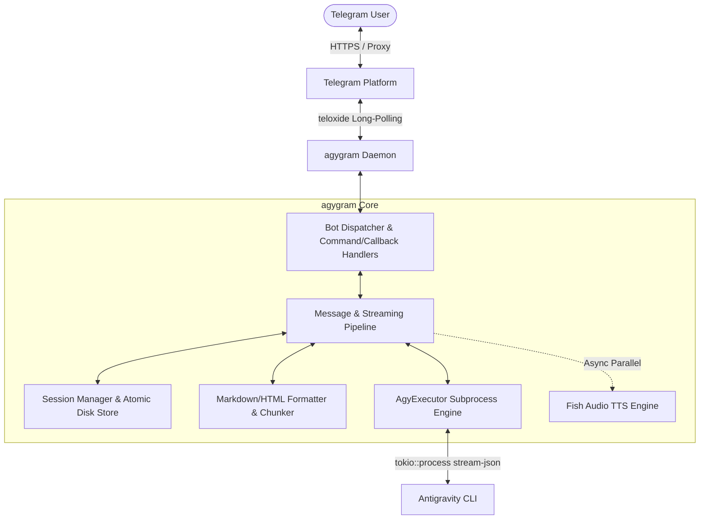

# 🚀 agygram

> **Next-Generation Antigravity CLI Telegram Daemon**
> 
> 专为 **Google Antigravity CLI (`agy`)** 打造的高性能 Telegram 守护进程，提供实时流式打字输出、多目录绑定、Quota 遥测看板与语音交互能力。

---

## ✨ 核心特性 (Key Features)

- ⚡ **Antigravity CLI 原生结构化流 (`--output-format stream-json`)**：
  - 实时解析 `stream-json` 事件流（精准区分 `text_delta` 增量、`thinking_delta` 思维链、`tool_call` 工具执行与 `usage` Token 遥测）；
  - 呈现极其清晰干净的实时打字预览与工具状态卡片。
- 🧠 **可折叠思维链 (Expandable Thinking Blockquotes)**：
  - 思维链自动渲染为 Telegram `<blockquote expandable>` 折叠块，界面整洁利落，一键轻触即可展开推导全貌。
- 🛠️ **专属工具执行徽章与参数高亮 (Smart Tool Badges)**：
  - 深度识别 `view_file` (📖), `run_command` (💻), `write_to_file` (📝), `grep_search` (🔍), `search_web` (🌐), `invoke_subagent` (🤖), `schedule` (⏰) 等工具并提取核心参数，拒绝晦涩原始 JSON。
- 📊 **毫秒级与 Token 级遥测看板 (High-Precision Telemetry)**：
  - 实时记录每轮对话 Prompt / Completion / Thinking / Cache 命中 Token 数与平均推理耗时，回复底部轻量呈现 `⏱ 2.4s • 🧠 1,450 tokens`。
- 🤖 **全面升级 Gemini 3.7 Flash 与全系顶级模型支持**：
  - 原生支持 `Gemini 3.7 Flash (High/Med/Low)`、`Gemini 3.6 Flash`、`Gemini 3.1 Pro`、`Claude Sonnet 4.6`、`Claude Opus 4.6 Thinking` 与 `GPT-OSS 120B`；
  - 提供超快捷模型别名（如 `/model 3.7`, `/model sonnet`, `/model pro`, `/model opus`）与精美网格内联键盘。
- 🔌 **Model Context Protocol (MCP) 与插件生态管理**：
  - 支持通过 `/mcp` 随时随地在 Telegram 中巡检服务端 MCP 工具与配置。
- 🔊 **申鹤语音回复与极速 TTS 架构 (Fish Audio Integration)**：
  - 支持 `/voice on`、`/voice off`、`/voice toggle` 与 `/voice <提问>`；
  - 异步并行生成高品质申鹤语音，不阻塞打字机流式输出。
- ✍️ **打字机级实时流式打字与平滑节流 (`draft_update_interval_ms`)**：
  - 结合 Tokio 异步通道与智能防抖去重，实时动态编辑草稿，杜绝 `429 Too Many Requests`。
- 🛑 **打断上一次任务 (Interrupt on New Message)**：
  - 当在同个 Chat 发送新消息/新需求时，系统自动秒级终止上次正在推导中的子进程（PID kill），瞬间接入最新推导。
- 📁 **媒体与文件传输全处理 (Photos, Documents, Voice & `/file`)**：
  - 自动接收 Telegram 用户发送的照片、文档、代码文件与语音，转存至工作目录并关联至 AI Prompt；
  - 支持 `/file <路径>`（支持 `~/...` 简写）直接将 VPS 上的任何代码、文档传输回 Telegram。

---

## 🏗️ 架构设计 (Architecture)



---

## 📋 指令速查表 (Command Reference)

| 指令 | 说明 | 示例 |
| :--- | :--- | :--- |
| `/start` / `/help` | 显示帮助菜单与完整指令列表 | `/help` |
| `/new` / `/reset` / `/clear` | 重置会话上下文与 Token 统计，开启全新对话 | `/new` 或 `/reset` |
| `/resume [<ID>]` | 恢复/接续历史对话 (空参数自动接续最近上下文) | `/resume` 或 `/resume 8de907d6` |
| `/status` | 查看当前会话配置、工作目录与交互控制卡片 | `/status` |
| `/usage` / `/quota` | 查看 Antigravity CLI Token 额度与实时遥测面板 | `/quota` |
| `/cd <path>` | 切换主工作目录 (支持 `~/...` 展开) | `/cd ~/project` |
| `/adddir <path>` | 添加附加项目工作目录 (对应 `--add-dir`) | `/adddir ~/lib` |
| `/cleardirs` | 清空所有附加的项目工作目录 | `/cleardirs` |
| `/dirs` / `/pwd` | 查看当前绑定的所有工作目录 | `/pwd` |
| `/model [<name>]` | 切换 AI 模型 (支持别名 `3.7`, `sonnet`, `pro` 或内联键盘选择) | `/model 3.7` |
| `/models` | 列出系统支持的全部 AI 模型列表 | `/models` |
| `/mcp` | 查看已配置的 MCP 服务器列表 | `/mcp` |
| `/plugins` | 查看已安装的 agy 插件列表 | `/plugins` |
| `/changelog` | 查看 agy CLI 最新更新日志 | `/changelog` |
| `/effort [<level>]` | 设置思考力度 (`low`, `medium`, `high`) | `/effort high` |
| `/mode [<mode>]` | 切换执行模式 (`accept-edits`, `plan`) | `/mode accept-edits` |
| `/agent [<name>]` | 切换指定的 Agent 智能体 | `/agent code-reviewer` |
| `/agents` | 列出系统可用的全部 Agent 列表 | `/agents` |
| `/system [<prompt>]`| 查看、设置或清空自定义 System Prompt | `/system clear` |
| `/file <path>` | 将 VPS 上的文件发送给 Telegram 用户 | `/file ~/.config/agygram/config.toml` |
| `/voice [on\|off\|toggle\|<text>]` | 申鹤语音回复控制或单次语音提问 | `/voice on` 或 `/voice 请介绍你自己` |
| `/cancel` | 紧急强行终止当前运行中的 `agy` 进程并释放锁 | `/cancel` |

---

## ⚙️ 配置文件说明 (Configuration)

支持一键复制模版文件创建配置：
```bash
mkdir -p ~/.config/agygram
cp config.example.toml ~/.config/agygram/config.toml
```

配置文件保存于 `~/.config/agygram/config.toml`：

```toml
# Telegram Bot Token (来自 @BotFather)
bot_token = "YOUR_TELEGRAM_BOT_TOKEN"

# 授权操作的 Telegram User ID 列表 (白名单，留空表示允许所有人)
allowed_user_ids = [123456789]

# 默认工作路径与模型配置
default_workspace = "~"
default_model = ""
default_effort = "high"
default_mode = "accept-edits"

# 代理设置 (可选，支持 HTTP / SOCKS5)
# proxy_url = "socks5://127.0.0.1:1080"

# 打字机流式更新最小间隔 (毫秒)
draft_update_interval_ms = 1000

# 收到新消息时打断上一任务 (实时交互模式)
interrupt_on_new_message = true

# 执行超时时间 (秒)
executor_timeout_secs = 300

# Telegram MTProto User API 配置 (可选)
# api_id = 12345678
# api_hash = "your_api_hash_here"

# Fish Audio TTS 语音合成密钥与参考音色 ID (可选)
# fish_api_key = "sk-fish-..."
# fish_reference_id = "..."
```

---

## 🔧 编译与运行 (Building & Running)

### 1. 编译项目
```bash
cargo build --release
```

### 2. 检查配置与环境
```bash
./target/release/agygram check
```

### 3. 运行服务
```bash
./target/release/agygram daemon
```

---

## 📜 许可证 (License)

本项目基于 MIT 许可证开源。遵循 Google Antigravity CLI 规范与Rust高性能代码实践

