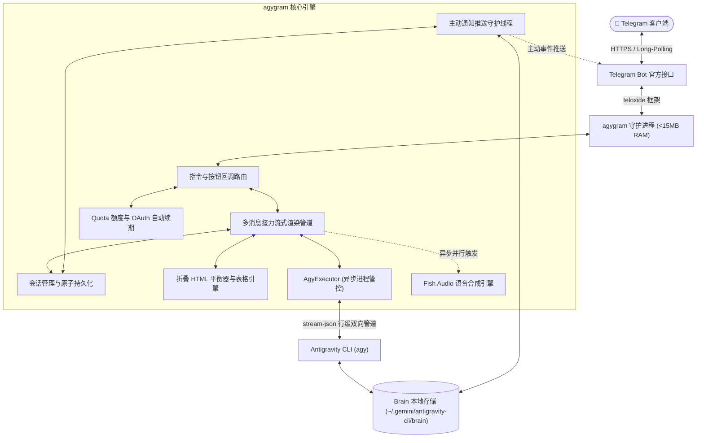

<div align="center">

# 🚀 agygram

**仅占 <15MB 内存的纯 Rust 守护进程 —— 将你的 Telegram 打造为 Google Antigravity CLI (`agy`) 的 24 小时随身移动控制中心。**

[](https://github.com/d3intran/agygram/releases)
[](#)
[](#)
[](https://www.rust-lang.org)
[](LICENSE)
[](#)

[English](README.md) • [简体中文](README_ZH.md)

</div>

---

## 💡 为什么你需要 agygram？

在云服务器（VPS）上部署全天候 AI Coding Agent（如 Claude Code、OpenClaw 等）通常面临两大劝退痛点：**一是官方 API 消耗极度昂贵**，跑几个复杂循环动辄几十美金；**二是运行环境臃肿**，Node.js / Docker 方案在 1C1G 的廉价/免费小鸡上极易爆内存（OOM）。

**Google Antigravity CLI (`agy`)** 提供了极具性价比的顶级模型配额（**Gemini 4 Argon**、**Claude Opus 5.5**、**Claude Sonnet 5.5**、**Gemini 3.8 Flash**、**GPT-OSS 120B**），而 **`agygram`** 则是用纯 Rust 打造的超轻量 Telegram 桥接守护进程：

- 🪶 **极致轻量，小鸡福音**：单静态二进制文件仅 **~6 MB**，空闲常驻内存 **< 15 MB**。无需 Docker、无需 Node.js，哪怕在 512MB~1GB 内存的免费云主机（如 Azure B2ats / AWS / Oracle 免费机）上也能 7×24 小时稳如泰山。
- 📱 **躺在床上遥控 VPS 与写代码**：无需在手机上折腾 SSH 终端。在地铁、通勤或外出时，打开 Telegram 发一句话，即可指挥服务器上的 Agent 自主修改代码、排查日志、运维系统或直接把服务器文件发回手机。
- 🔔 **定时任务与后台通知主动推送**：当你在对话中说 *“10 分钟后提醒我检查构建”* 或触发耗时的后台 Subagent 时，`agygram` 内置的主动监听线程会在任务完成的第一时间向 Telegram 推送通知，无需手动发消息轮询。
- 📊 **一键可视化额度看板与秒切模型**：发送 `/quota` 即可查看全系模型的实时剩余百分比进度条与重置倒计时；发送 `/status` 即可通过原地内联按钮秒切 **Gemini 4 Argon**、**Claude 5.5** 等任意模型。

---

## 📱 Telegram 手机端交互界面预览

```text
┌──────────────────────────────────────────┐  ┌──────────────────────────────────────────┐
│ 📊 当前会话配置控制台 (/status)           │  │ 📊 Antigravity 模型状态与配额 (/quota)    │
│                                          │  │                                          │
│ • 工作目录: /home/dev/my-app              │  │ • 账号: dev@example.com (Free Tier)      │
│ • AI 模型: gemini-4-argon-medium         │  │                                          │
│ • 思考力度: medium  | 执行模式: auto      │  │ 🔹 Gemini 4 Argon / 3.8 Flash            │
│ • 运行状态: ✅ 空闲                       │  │   [████████░░] 80% · ⏳ 3h 42m 后重置    │
│                                          │  │ 🔹 Claude Opus 5.5 / Sonnet 5.5          │
│ [ 🤖 切换模型 ]       [ ⚡ 思考力度 ]     │  │   [██████████] 100% · ⏳ 4h 59m 后重置   │
│ [ 🎯 执行模式 ]       [ 🛡️ 开启沙盒 ]     │  │ 🔹 GPT-OSS 120B                          │
│ [ 📊 实时额度 ]       [ 📜 历史会话 ]     │  │   [██████████] 100% · ⏳ 4h 59m 后重置   │
│ [ 🔊 开启语音 ]       [ 🔄 重置会话 ]     │  │                                          │
└──────────────────────────────────────────┘  └──────────────────────────────────────────┘
```

---

## ⚡ 30 秒免编译极速安装（推荐）

> [!TIP]
> **无需安装 Rust 编译器，无需在 VPS 上本地编译！** 直接下载 GitHub Releases 预编译好的静态二进制文件，30 秒即可完成部署，彻底避免小内存服务器编译卡死。

### 第一步：前置条件
确保你的 Linux 服务器已安装并登录好 **Google Antigravity CLI (`agy`)**：
```bash
agy --version
```

### 第二步：一行命令下载与交互式初始化
```bash
# 1. 下载最新预编译 Linux x86_64 二进制文件 (约 6MB)
curl -fsSL https://github.com/d3intran/agygram/releases/latest/download/agygram -o ~/agygram
chmod +x ~/agygram

# 2. 运行交互式配置向导
~/agygram init
```
*(根据终端提示，填入从 `@BotFather` 获取的 Bot Token 以及从 `@userinfobot` 获取的你的纯数字 Telegram User ID，自动生成 `~/.config/agygram/config.toml`)*

### 第三步：一键配置 Systemd 开机自启服务（整段复制即用）
直接复制以下整段命令到终端执行，脚本会**自动识别你当前的 Linux 用户名与主目录**，无需手动修改任何路径：

```bash
sudo tee /etc/systemd/system/agygram.service > /dev/null <<EOF
[Unit]
Description=agygram Telegram Bot Daemon Service
After=network.target network-online.target
Wants=network-online.target

[Service]
Type=simple
User=$(whoami)
WorkingDirectory=$HOME
ExecStart=$HOME/agygram daemon
Restart=always
RestartSec=5s
Environment=PATH=/usr/local/bin:/usr/bin:/bin:$HOME/.local/bin:$HOME/.cargo/bin
Environment=HOME=$HOME

[Install]
WantedBy=multi-user.target
EOF

sudo systemctl daemon-reload
sudo systemctl enable --now agygram
sudo systemctl status agygram --no-pager
```

### 🔄 日后一键平滑升级
后续有新版本发布时，只需在终端执行一行命令即可自动下载替换并平滑重启守护进程：
```bash
bash <(curl -fsSL https://raw.githubusercontent.com/d3intran/agygram/main/update.sh)
```

---

## ✨ 核心特性矩阵

| 特性分类 | 功能描述 |
| :--- | :--- |
| 🔔 **主动通知推送守护** | 独立常驻守护线程监控本地 Brain 消息队列，当后台异步任务完成或 `schedule` 定时器到达时，主动即时推送到 Telegram 聊天框。 |
| 🚀 **多消息接力流式打字** | 回答超过 4,000 字符时自动固化前序消息并无缝开启下一条消息接力流式输出，彻底突破 Telegram 单条 4096 字符限制。 |
| 🤖 **全系官方模型与动态校验** | 原生支持 `Gemini 4 Argon` (High/Med/Low)、`Gemini 3.8 Flash`、`Claude Opus 5.5`、`Claude Sonnet 5.5`、`GPT-OSS 120B`，并支持动态读取 `agy models` 自动兼容未来新模型。 |
| 📊 **实时额度遥测与自动续期** | 深度集成 `agy /quota` 与 Google OAuth 自动刷新机制，支持双通道容灾切换，在手机端和终端（`agygram quota`）随时查看配额进度条。 |
| 🧠 **原生折叠深度推理卡片** | 利用 Telegram `<blockquote expandable>` 原生折叠块封装海量 Thinking 思考链与长命令输出，手机屏幕清爽不刷屏。 |
| 🎛️ **多级原地控制面板** | `/status` 提供单条消息原地刷新的交互式控制面板，点按按钮即可切换模型、思考力度、运行模式（`auto` / `accept-edits` / `plan`）与沙盒开关。 |
| 📊 **CJK 对齐 ASCII 表格** | 自动计算中日韩宽字符显示宽度，将 Markdown 表格转换为手机端绝不乱行的 `<pre><code>` 等宽框线表。 |
| 🖼️ **生成产物自动直传** | 严格在工作目录沙盒内自动检测新生成的图片（`.png`/`.jpg`）与文档（`.pdf`/`.json`/`.csv`），并作为 Telegram 原生附件自动推送。 |
| 🔊 **自定义 AI 角色语音 (TTS)** | 可选接入 Fish Audio 异步并行语音合成，自动过滤代码块与工具日志，支持在 `config.toml` 中自由配置任意自定义音色 `reference_id`。 |
| 🛑 **优雅任务中断与防死锁** | 发送新消息或 `/cancel` 秒级打断正在运行的任务（优先 `SIGINT` 保全会话记录，超时升级 `SIGKILL`），后台挂起任务自动脱壳防死锁。 |

---

## 🏗️ 架构拓扑图



---

## 📋 指令速查手册

### 🔄 会话与状态控制
| 指令 | 说明 | 示例 |
| :--- | :--- | :--- |
| `/status` | 打开多级原地交互控制面板（切换模型/模式/思考力度/查额度） | `/status` |
| `/quota` / `/usage` | 查看 Antigravity 账号实时模型配额百分比与重置倒计时 | `/quota` |
| `/new` / `/reset` / `/clear` | 开启全新对话（重置上下文与统计计数器） | `/new` |
| `/resume [<ID>]` | 接续历史对话（留空默认接续最近一次会话） | `/resume` 或 `/resume 8de907d6` |
| `/history` | 查看当前 VPS 上最近活跃的历史会话并点击一键接续 | `/history` |
| `/cancel` | 紧急中断正在运行的任务并释放会话锁 | `/cancel` |

### 🤖 模型与运行设置
| 指令 | 说明 | 示例 |
| :--- | :--- | :--- |
| `/model [<name>]` | 切换 AI 模型（支持别名：`argon`, `3.8`, `opus`, `sonnet`, `oss`） | `/model argon` |
| `/models` | 列出当前 Antigravity CLI 支持的全部 AI 模型 | `/models` |
| `/effort [<level>]` | 设置思考力度（`low`, `medium`, `high`, `xhigh`, `max`） | `/effort high` |
| `/mode [<mode>]` | 切换运行模式（`auto`, `accept-edits`, `plan`） | `/mode auto` |
| `/agent [<name>]` | 切换指定的 Agent 智能体身份 | `/agent code-reviewer` |
| `/system [<prompt>]`| 查看、设置或清空自定义 System Prompt | `/system 请全程用中文严谨回答` |
| `/voice [on\|off\|toggle\|<text>]` | 控制 AI 语音回复模式或发送单次语音提问 | `/voice on` |

### 📂 目录、文件与 Brain 生态
| 指令 | 说明 | 示例 |
| :--- | :--- | :--- |
| `/cd <path>` | 切换主工作目录（支持 `~/...` 展开） | `/cd ~/projects/my-app` |
| `/adddir <path>` | 附加额外项目工作目录（对应 `--add-dir`） | `/adddir ~/libs/shared` |
| `/dirs` / `/pwd` | 查看当前绑定的所有工作目录 | `/pwd` |
| `/file <path>` | 从 VPS 直接下载指定文件到 Telegram 聊天框 | `/file ~/my-app/config.toml` |
| `/plan` / `/walkthrough` | 查看当前会话的架构设计方案或执行验收报告 | `/plan` |
| `/skills` / `/rules` / `/mcp` | 查看已启用的技能库、全局规则与 MCP 服务配置 | `/mcp` |

---

## 🛠️ 从源码编译（面向开发者）

<details>
<summary><b>点击展开源码构建说明</b></summary>

> **注意**：由于开启了 Fat LTO 极致体积与性能优化，Rust 编译峰值需要约 1.5 GB 以上可用内存。如果你的 VPS 内存较小（如 1GB 内存机型），请直接使用上方 **“30 秒免编译极速安装”** 下载预编译二进制，或通过 GitHub Actions 云端构建。

```bash
# 1. 安装 Rust 工具链
curl --proto '=https' --tlsv1.2 -sSf https://sh.rustup.rs | sh

# 2. 克隆仓库并编译
git clone https://github.com/d3intran/agygram.git
cd agygram
cargo build --release

# 3. 编译产物位于 target/release/agygram
./target/release/agygram --version
```
</details>

---

## ❓ 常见问题排查 (FAQ)

<details>
<summary><b>Q1: 提示 "权限不足：用户 ID 未在授权名单中"？</b></summary>
出于服务器安全考量，<code>agygram</code> 默认强制启用纯数字 Telegram User ID 白名单校验。在 Telegram 中私聊 <code>@userinfobot</code> 获取你的纯数字 ID，填入 <code>~/.config/agygram/config.toml</code> 的 <code>allowed_user_ids = [你的ID]</code> 并执行 <code>sudo systemctl restart agygram</code> 即可。
</details>

<details>
<summary><b>Q2: 后台定时任务 (schedule) 如何自动通知我？</b></summary>
当你对 Agent 说<i>“10分钟后提醒我检查日志”</i>，底层 <code>schedule</code> 定时器触发时，<code>agygram</code> 的 Proactive Notifier 守护线程会自动捕获事件并以 <code>⏰ 【定时提醒】</code> 格式主动推送到你的 Telegram，无需你发新消息去唤醒。
</details>

<details>
<summary><b>Q3: 如何配置 Socks5 / HTTP 代理或自定义语音音色？</b></summary>
编辑 <code>~/.config/agygram/config.toml</code>：
<ul>
  <li><b>代理配置</b>：取消 <code>proxy_url</code> 注释并填入地址，如 <code>proxy_url = "socks5://127.0.0.1:1080"</code>。</li>
  <li><b>自定义 TTS 音色</b>：填入 <code>fish_api_key</code> 与 Fish Audio 平台上任意声音模型的 <code>fish_reference_id</code> 即可拥有专属语音助手。</li>
</ul>
</details>

---

## 📜 开源协议

本项目基于 [MIT License](LICENSE) 开源。
