<div align="center">

# 🚀 agygram

**将你的 Telegram 打造为 Google Antigravity CLI 的高性能全自主移动控制中心。**

[](https://github.com/d3intran/agygram/releases)
[](https://www.rust-lang.org)
[](https://github.com/d3intran/agygram)
[](LICENSE)
[](#)

[English](README.md) • [简体中文](README_ZH.md)

<br/>

```
┌─────────────────────────────────────────────────────────────────────────┐
│ Telegram 客户端                  agygram 守护进程 (v1.4.1)               │
│                                                                         │
│ 🧑 用户: "重构 API 并设10m提醒" ──> ⚡ 零延迟内存事件摄取队列              │
│                                     │                                   │
│ 🤖 agy: <blockquote expandable> <── ✍️ 多消息接力打字机流式渲染         │
│ 🤖 agy: <code>code...</code>        ├── 🧠 Brain 本地会话持久化与接续   │
│ ⏰ [定时提醒主动推送到TG!]      <── ├── 🔔 异步任务/Timer 主动推送守护   │
│ 🖼️ [架构图.png 自动传输]        <── ├── 📦 严格沙盒局限的生成产物推送   │
│ 🎙️ [申鹤专属语音条合成]         <── └── 🔊 Fish Audio TTS 异步并行合成   │
└─────────────────────────────────────────────────────────────────────────┘
```

</div>

---

## 💡 为什么选择 agygram？

**Google Antigravity CLI (`agy`)** 是目前最强大的智能代理编程 CLI 之一。然而开发者常常面临跨端痛点：通勤途中通过手机跟进任务、在笔记本上轻量触发 VPS 脚本执行，或希望能随时随地指挥 Agent 而无需时刻驻留 SSH 终端。

**agygram** 专为连接 Telegram 与 `agy` 而生，提供高可用、零延迟的企业级守护进程：

* **🔔 异步后台任务与定时器主动推送 (v1.4.0)**：彻底解决底层 `schedule` 定时提醒无法触达 Telegram 的痛点。后台异步任务完成、定时器触发或 Subagent 交付成果时，守护进程自动侦测并主动推送，无需用户手动再发消息唤醒！
* **🚀 超长回答多消息接力流式打字机 (v1.4.0)**：打破 Telegram 单条 4,096 字符限制！长篇架构方案或万字代码生成时，前序分块自动固化封口，后续分块实时创建新消息接力流式打字，全程动态可见。
* **🎯 全面支持 `auto` 全自主模式 (v1.4.0)**：除原有 `accept-edits` 与 `plan` 模式外，完整解锁 `auto` 智能自主决策模式。
* **🧠 原生折叠推理与命令卡片 (v1.4.0)**：基于 Telegram Bot API 7.2+ 原生 `<blockquote expandable>` 折叠块，将海量 Thinking 思考链与冗长命令日志折叠展示，杜绝移动端刷屏。
* **📐 原生 LaTeX 数学公式渲染 (v1.4.0)**：自动转换行内 `$x$` 与块级 `$$...$$` 公式为美观等宽渲染，防止符号冲突。
* **🛡️ 工作目录智能容错与路径恢复 (v1.4.0)**：原生支持 `~` 用户主目录展开，若目标目录不存在自动安全回退至 `$HOME` 并建立 `scratch`，防止 Linux OS error 2 启动崩溃。
* **⚡ OAuth 凭证全自动保活与双通道 Quota 容灾 (v1.4.1)**：内置 Google OAuth Refresh 机制，Token 即将过期或收到 401 时自动换取新凭证并持久化；支持 `cloudcode-pa` 生产端点与 `daily-cloudcode-pa` 双通道自动故障切换；新增 `agygram quota` 命令行一键诊断，彻底告别额度查询异常。
* **流式标签零报错**：内置增量流式 HTML 平衡器，在生成过程中自动闭合半截标签（`<pre>`, `<code>`, `<blockquote>`），杜绝 Telegram 400 Bad Request。
* **本地 Brain 深度接续**：直接监听 `~/.gemini/antigravity-cli/brain/`，一键 `/history` 恢复会话，随时查看 `/plan` 方案与 `/walkthrough` 执行报告。

---

## ✨ 核心特性矩阵

| 特性分类 | 功能描述 |
| :--- | :--- |
| 🔔 **主动推送守护** *(1.4.0 新增)* | 独立常驻守护线程监控 Brain 消息队列，后台任务完成与 `schedule` 定时器到达时主动即时推送到 Telegram 聊天框。 |
| 🚀 **多消息接力流式** *(1.4.0 新增)* | 超过 4,000 字符时无缝开启下一条消息接力流式输出，彻底解决 Telegram 4096 字符截断问题。 |
| 🎯 **全自主 `auto` 模式** *(1.4.0 新增)* | 原生支持 `auto` 模式，允许 Agent 自由决定是直接修改文件还是先行规划方案。 |
| 🧠 **折叠式深度推理** *(1.4.0 新增)* | Thinking 思考过程与长参数命令日志封装进 `<blockquote expandable>` 原生折叠卡片，移动端清爽易读。 |
| 📐 **LaTeX 公式排版** *(1.4.0 新增)* | 自动解析数学公式并渲染为安全美观的代码块。 |
| 🛡️ **目录容错与防抖** *(1.4.0 新增)* | 路径智能展开并防御性回退，高速生成自适应合并 Draft 规避 429 限流。 |
| ⚡ **打字机流式输出** | 基于 `stream-json` 行协议内存级摄取，支持 Telegram 429 指数退避自适应防限流。 |
| 🎛️ **多级原地控制板** | `/status` 提供单条消息原地刷新的交互式控制面板，随意切换模型、思考力度与运行模式。 |
| 📊 **等宽 ASCII 适配表格** | 将 Markdown 复杂表格转换为东亚字符精准对齐的 ASCII Box 表格，手机阅读不乱行。 |
| 🖼️ **产物安全自动投递** | 仅对工作目录与关联工程目录进行严格沙盒校验，自动检测新生成的图片或文档附件并上传推送。 |
| 🤖 **顶级模型矩阵** | 快捷切换 `Gemini 4 Argon` (High/Med/Low), `Gemini 3.8 Flash` (High/Med/Low), `Claude Opus 5.5`, `Claude Sonnet 5.5`, `GPT-OSS 120B`。 |
| 🔊 **申鹤专属 TTS 语音** | 基于 Fish Audio 的角色模型异步并行语音合成，一键收听语音回复。 |
| 🛑 **优雅任务打断机制** | 收到新消息时支持自动打断正在运行的任务，优先发送 `SIGINT` 保全脑图数据，再优雅终止进程。 |

---

## 🏗️ 架构拓扑图

```mermaid
flowchart TD
    User(["📱 Telegram 客户端"]) <-->|HTTPS / Long-Polling| BotAPI["Telegram Bot 官方接口"]
    BotAPI <-->|teloxide 框架| Daemon["agygram 守护进程"]

    subgraph agygram_Core ["agygram 核心引擎 (v1.4.0)"]
        Dispatcher["指令与消息分发路由"]
        Pipeline["多消息接力流式渲染管道"]
        SessionMgr["会话管理与原子持久化"]
        Formatter["折叠 HTML 平衡器与表格引擎"]
        Executor["AgyExecutor (tokio 异步进程管控)"]
        Notifier["主动通知推送守护线程"]
        TTS["Fish Audio 语音合成引擎"]
    end

    Daemon <--> Dispatcher
    Dispatcher <--> Pipeline
    Pipeline <--> SessionMgr
    Pipeline <--> Formatter
    Pipeline <--> Executor
    Pipeline -.->|异步并行触发| TTS
    Notifier <--> SessionMgr
    Notifier -.->|主动事件推送| BotAPI

    Executor <-->|"stream-json 行级双向管道"| AgyCLI["Antigravity CLI (agy)"]
    AgyCLI <--> BrainStore[("Brain 本地数据存储 (~/.gemini/antigravity-cli/brain)")]
    Notifier <--> BrainStore
```



---

## 🚀 极速上手指南

### 第一步：环境准备
- 确保系统已安装并配置好 **Google Antigravity CLI (`agy`)**（运行 `agy --version` 验证）。
- 如需从源码编译，请准备 Rust 工具链：
  ```bash
  curl --proto '=https' --tlsv1.2 -sSf https://sh.rustup.rs | sh
  ```

### 第二步：获取源码与编译
```bash
git clone https://github.com/d3intran/agygram.git
cd agygram
cargo build --release
```
编译完成的优化二进制位于 `target/release/agygram`（开启了 Fat LTO 与符号剥离，体积仅约 6.0 MB）。

### 第三步：交互式配置向导
直接执行交互向导，在终端中分步录入你的 Bot Token、授权 User ID 与工作目录：
```bash
./target/release/agygram init
```
*(你也可以手动拷贝 `config.example.toml` 到 `~/.config/agygram/config.toml`)*

### 第四步：检查并启动
```bash
# 验证配置文件与 agy CLI 路径
./target/release/agygram check

# 前台调试启动守护进程
./target/release/agygram daemon
```

---

## 🛠️ 生产环境部署 (Systemd 守护进程)

推荐将 `agygram` 配置为系统服务，实现开机自启、崩溃自动拉起与日志聚合：

1. **新建 Systemd Unit 文件**：
   ```bash
   sudo nano /etc/systemd/system/agygram.service
   ```

2. **填入以下配置**（根据实际情况替换 `azureuser` 与路径）：
   ```ini
   [Unit]
   Description=agygram Telegram Bot Daemon Service
   After=network.target network-online.target
   Wants=network-online.target

   [Service]
   Type=simple
   User=azureuser
   WorkingDirectory=/home/azureuser
   ExecStart=/home/azureuser/agygram daemon
   Restart=always
   RestartSec=5s
   Environment=PATH=/usr/local/bin:/usr/bin:/bin:/home/azureuser/.local/bin:/home/azureuser/.cargo/bin
   Environment=HOME=/home/azureuser

   [Install]
   WantedBy=multi-user.target
   ```

3. **重载并启动服务**：
   ```bash
   sudo systemctl daemon-reload
   sudo systemctl enable agygram
   sudo systemctl start agygram
   sudo systemctl status agygram
   ```

---

## 📋 指令速查手册

### 🔄 会话与状态控制
| 指令 | 说明 | 示例 |
| :--- | :--- | :--- |
| `/status` | 打开多级原地交互控制面板（切换模型/模式/思考力度） | `/status` |
| `/new` / `/reset` / `/clear` | 重置当前对话上下文与统计计数器 | `/new` |
| `/resume [<ID>]` | 接续历史对话（留空接续最近一次会话） | `/resume` 或 `/resume 8de907d6` |
| `/cancel` | 紧急中断正在运行的任务并释放前台锁 | `/cancel` |
| `/usage` / `/quota` | 查看 Antigravity 账号 Token 额度与遥测面板 | `/quota` |

### 🧠 Brain 方案与生态
| 指令 | 说明 | 示例 |
| :--- | :--- | :--- |
| `/history` | 查看当前机器上所有的历史会话并一键接续 | `/history` |
| `/plan` | 查看当前会话的架构设计方案 (`implementation_plan.md`) | `/plan` |
| `/walkthrough` | 查看当前会话的执行验收报告 (`walkthrough.md`) | `/walkthrough` |
| `/skills` | 查看已启用的 Antigravity 技能库 (Skills) | `/skills` |
| `/rules` | 查看当前生效的全局与项目规则 | `/rules` |
| `/mcp` | 查看与管理绑定的 MCP 服务器 | `/mcp` |
| `/plugins` | 查看已安装的 agy 插件列表 | `/plugins` |
| `/changelog` | 查看 agy CLI 官方最新更新日志 | `/changelog` |

### 📂 目录与工程
| 指令 | 说明 | 示例 |
| :--- | :--- | :--- |
| `/cd <path>` | 切换主工作目录（支持 `~/...` 缩写） | `/cd ~/projects/my-app` |
| `/adddir <path>` | 附加工作目录（对应 `--add-dir`） | `/adddir ~/libs/shared` |
| `/cleardirs` | 清空所有附加的工作目录 | `/cleardirs` |
| `/dirs` / `/pwd` | 查看当前绑定的所有工作目录 | `/pwd` |
| `/file <path>` | 从 VPS 传输任意受限文件到 Telegram | `/file ~/.config/agygram/config.toml` |

### 🤖 模型与运行设置
| 指令 | 说明 | 示例 |
| :--- | :--- | :--- |
| `/model [<name>]` | 切换 AI 模型（支持别名：`3.8`, `sonnet`, `opus`, `oss`） | `/model 3.8` |
| `/models` | 列出系统支持的全部 AI 模型 | `/models` |
| `/effort [<level>]` | 设置思考力度（`low`, `medium`, `high`, `xhigh`, `max`） | `/effort high` |
| `/mode [<mode>]` | 切换模式（`auto`, `accept-edits`, `plan`） | `/mode auto` |
| `/agent [<name>]` | 切换指定的 Agent 智能体身份 | `/agent code-reviewer` |
| `/agents` | 列出系统所有可用的 Agent | `/agents` |
| `/system [<prompt>]`| 查看、设置或清空自定义 System Prompt | `/system 请全程用中文严谨回答` |
| `/voice [on\|off\|toggle\|<text>]` | 控制申鹤语音回复模式或提交一次性语音生成任务 | `/voice on` 或 `/voice 介绍一下你自己` |

---

## ❓ 常见问题排查 (FAQ)

<details>
<summary><b>Q1: 提示 "权限不足：用户 ID 未在授权名单中"？</b></summary>
出于 VPS 系统与代码执行安全考量，`agygram` 默认强制开启数字 Telegram User ID 白名单过滤。在 Telegram 中私聊 <code>@userinfobot</code> 获取你的纯数字 ID，写入 <code>~/.config/agygram/config.toml</code> 中的 <code>allowed_user_ids = [你的ID]</code> 并重启服务即可。若需对所有人公开使用，需在配置中显式声明 <code>allow_all_users = true</code>。
</details>

<details>
<summary><b>Q2: 后台定时任务 (schedule) 如何自动通知我？</b></summary>
在 v1.4.0 中，当你对 Agent 说<i>“10分钟后提醒我喝水”</i>，底层的 `schedule` 任务在时间到达触发时，守护进程的 Proactive Notifier 线程会自动捕获消息队列并以原生 <code>⏰ 【定时提醒】</code> 格式主动推送到 Telegram，彻底告别必须发新消息才刷出通知的旧逻辑！
</details>

<details>
<summary><b>Q3: 如何配置 Socks5 / HTTP 代理？</b></summary>
取消 <code>~/.config/agygram/config.toml</code> 中的 <code>proxy_url</code> 注释并填入本地代理地址，例如：<code>proxy_url = "socks5://127.0.0.1:1080"</code> 或 <code>proxy_url = "http://127.0.0.1:7890"</code>。
</details>

---

## 📜 开源协议

本项目基于 **MIT License** 开源。完全遵循 Google Antigravity CLI 规范与现代 Rust 异步高并发最佳工程实践。
