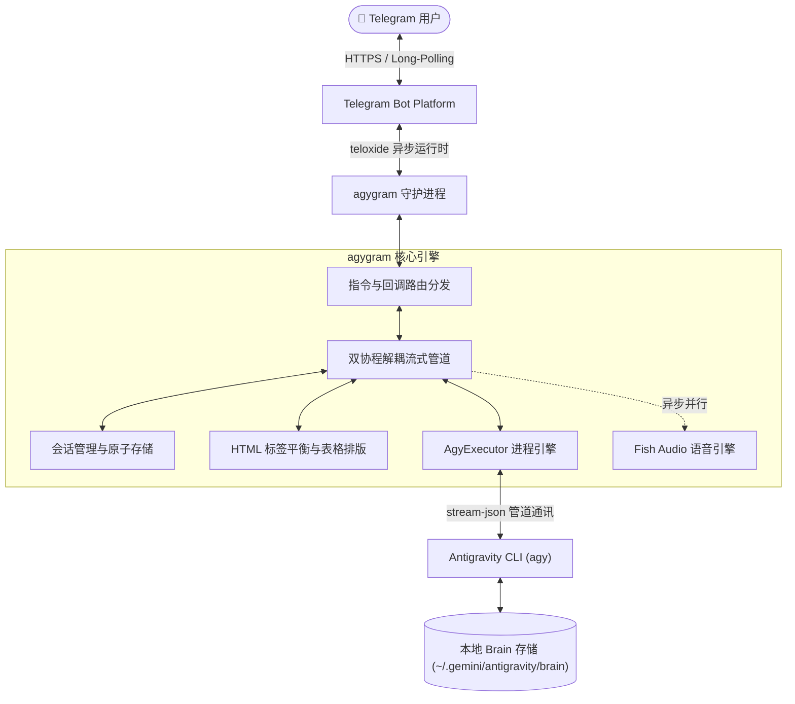

<div align="center">

# 🚀 agygram

**将你的 Telegram 打造成 Google Antigravity CLI 的高性能随身指挥中心。**

[](https://www.rust-lang.org)
[](https://github.com/d3intran/agygram)
[](LICENSE)
[](#)

[English](README.md) • [简体中文](README_ZH.md)

<br/>

```
┌─────────────────────────────────────────────────────────────┐
│ Telegram 客户端             agygram 守护进程                │
│                                                             │
│ 🧑 用户: "重构后端API" ──> ⚡ 内存事件队列 (微秒级零反压)    │
│                             │                               │
│ 🤖 agy: <i>思考中...</i>   <── ✍️ 定时渲染草稿 (1000ms)    │
│ 🤖 agy: <code>代码块</code>   ├── 🧠 Brain 会话接续 (~/brain) │
│ 🖼️ [生成图片.png]       <── ├── 📦 产物文件自动直传         │
│ 🎙️ [申鹤语音回复.mp3]   <── └── 🔊 Fish Audio TTS (并行异步)│
└─────────────────────────────────────────────────────────────┘
```

</div>

---

## 💡 为什么选择 agygram？

**Google Antigravity CLI (`agy`)** 拥有极其强大的自主编码与项目规划能力。然而在日常开发中，我们经常需要在外出通勤、离开电脑时通过手机监控任务进展、接续历史对话、审查代码方案或触发自动化任务。

**agygram** 为此而生，通过深度定制的 Telegram 守护进程带来媲美本地终端的交互体验：

* **⚡ 管道无阻塞解耦**：采用生产-消费双协程架构，以纯内存速率读取 CLI 标准输出，彻底消除 Telegram 网络 RTT 对 `agy` 进程的反压，保持 CLI 原生极速推导。
* **⚖️ 增量 HTML 标签平衡器**：实时修补流式阶段未闭合的代码块 `<pre><code>` 与 `<blockquote>` 标签，杜绝 Telegram 400 格式解析报错导致的断流。
* **🧠 本地 Brain 存储无缝接续**：直接扫描 `~/.gemini/antigravity/brain/`，一键通过 `/history` 接续历史会话，随时通过 `/plan` 与 `/walkthrough` 调阅架构设计与总结报告。
* **🎛️ 原地无缝多级控制板**：`/status` 控制台支持原地切换模型、思考力度 (Effort)、执行模式与语音开关，附带 `« 返回控制板` 导航，杜绝消息刷屏。
* **🖼️ 产物与文件自动直传**：AI 产出的图片 (`.png`/`.jpg`)、图表或数据文档 (`.pdf`/`.json`/`.csv`) 会被自动捕获并直接推送到 Telegram。

---

## ✨ 核心特性一览

| 核心特性 | 功能描述 |
| :--- | :--- |
| ⚡ **打字机级流式输出** | 原生解析 `stream-json` 事件流，支持内存级解耦与 Telegram 429 智能避让。 |
| 🧠 **本地 Brain 会话联动** | 支持 `/history` 一键内联按钮接续，支持在手机端直接调阅 `/plan` 方案与 `/walkthrough` 报告。 |
| 🎛️ **原地交互控制面板** | `/status` 呈现完整状态卡片，支持多级原地菜单切换与返回，彻底消除重复消息。 |
| 📊 **等宽 ASCII 表格排版** | 自动将 Markdown 表格转换为移动端友好的 `<pre><code>` 框线文本，杜绝手机端折行错位。 |
| 🖼️ **生成产物文件直传** | 自动感知并直接推送生成的图片与文件产物，无需额外执行传输指令。 |
| 🤖 **全系顶级模型支持** | 原生支持 `Gemini 3.7 Flash`、`Gemini 3.1 Pro`、`Claude Sonnet 4.6`、`Claude Opus 4.6` 与 `GPT-OSS 120B`。 |
| 🔊 **申鹤语音回复引擎** | 基于 Fish Audio 的异步并行语音合成，不阻塞打字机文本流输出。 |
| 🛑 **平滑优雅任务中断** | 发送新指令秒级打断上一次任务（`SIGINT` 优先保障会话记录完整，超时升级 `SIGKILL`）。 |
| 🛡️ **生产级安全与容灾** | 严格的 Telegram User ID 纯数字白名单校验，会话状态原子 JSON 持久化。 |

---

## 🏗️ 系统架构设计



---

## 🚀 60 秒极速上手指南

### 第一步：环境准备
- 确保系统已安装并配置好 **Google Antigravity CLI (`agy`)**（运行 `agy --version` 确认可用）。
- 安装 Rust 工具链（若自行编译）：
  ```bash
  curl --proto '=https' --tlsv1.2 -sSf https://sh.rustup.rs | sh
  ```

### 第二步：获取源码与编译
```bash
git clone https://github.com/d3intran/agygram.git
cd agygram
cargo build --release
```
编译产物位于 `target/release/agygram`（体积仅 ~5.6MB，经过 LTO 与符号剥离极致优化）。

### 第三步：交互式快速配置向导 (Init Wizard)
运行内置交互向导，几秒内完成 Bot Token、授权 User ID 与工作目录的引导配置：
```bash
./target/release/agygram init
```
*(亦可手动复制 `config.example.toml` 到 `~/.config/agygram/config.toml` 进行自定义编辑)*

### 第四步：环境自检与启动
```bash
# 检查配置文件与 agy CLI 路径有效性
./target/release/agygram check

# 前台启动守护进程测试
./target/release/agygram daemon
```

---

## 🛠️ 生产环境部署 (Systemd Service)

将 `agygram` 注册为 Linux 系统守护服务，实现开机自启与故障自动拉起：

1. **创建服务单元文件**：
   ```bash
   sudo nano /etc/systemd/system/agygram.service
   ```

2. **写入以下配置**（根据实际用户与路径替换）：
   ```ini
   [Unit]
   Description=agygram Telegram Bot Daemon Service
   After=network.target network-online.target
   Wants=network-online.target

   [Service]
   Type=simple
   User=azureuser
   WorkingDirectory=/home/azureuser
   ExecStart=/home/azureuser/agygram daemon
   Restart=always
   RestartSec=5s
   Environment=PATH=/usr/local/bin:/usr/bin:/bin:/home/azureuser/.local/bin:/home/azureuser/.cargo/bin
   Environment=HOME=/home/azureuser

   [Install]
   WantedBy=multi-user.target
   ```

3. **启动并启用开机自启**：
   ```bash
   sudo systemctl daemon-reload
   sudo systemctl enable agygram
   sudo systemctl start agygram
   sudo systemctl status agygram
   ```

---

## 📋 指令速查表 (Command Reference)

### 🔄 会话与全局控制
| 指令 | 作用说明 | 使用示例 |
| :--- | :--- | :--- |
| `/status` | 打开多级原地交互控制卡片（模型、Effort、Mode 等） | `/status` |
| `/new` / `/reset` / `/clear` | 重置会话上下文与统计，开启全新会话 | `/new` 或 `/reset` |
| `/resume [<ID>]` | 恢复/接续历史对话（缺省参数自动接续最近上下文） | `/resume` 或 `/resume 8de907d6` |
| `/cancel` | 紧急平滑终止当前运行中的 `agy` 任务并释放锁 | `/cancel` |
| `/usage` / `/quota` | 查看 Antigravity CLI Token 详细额度与遥测面板 | `/quota` |

### 🧠 Antigravity Brain 与生态
| 指令 | 作用说明 | 使用示例 |
| :--- | :--- | :--- |
| `/history` | 查看 VPS 活跃历史会话列表，支持一键内联点击接续 | `/history` |
| `/plan` | 查看当前会话的架构设计方案 (`implementation_plan.md`) | `/plan` |
| `/walkthrough` | 查看当前会话的任务验证与执行总结 (`walkthrough.md`) | `/walkthrough` |
| `/skills` | 巡检并列出已挂载的 Antigravity 技能库 (Skills) | `/skills` |
| `/rules` | 查看当前生效的全局与项目规则 (Rules) | `/rules` |
| `/mcp` | 查看已配置的 MCP 服务器列表 | `/mcp` |
| `/plugins` | 查看已安装的 agy 插件列表 | `/plugins` |
| `/changelog` | 查看 agy CLI 最新更新日志 | `/changelog` |

### 📂 工作目录与文件管理
| 指令 | 作用说明 | 使用示例 |
| :--- | :--- | :--- |
| `/cd <path>` | 切换主工作目录（支持 `~/...` 简写） | `/cd ~/projects/my-app` |
| `/adddir <path>` | 添加附加项目工作目录（对应 `--add-dir`） | `/adddir ~/libs/shared` |
| `/cleardirs` | 清空所有附加的项目工作目录 | `/cleardirs` |
| `/dirs` / `/pwd` | 查看当前绑定的所有工作目录路径 | `/pwd` |
| `/file <path>` | 将 VPS 上的任何文件发送给 Telegram 用户 | `/file ~/.config/agygram/config.toml` |

### 🤖 模型与语音设置
| 指令 | 作用说明 | 使用示例 |
| :--- | :--- | :--- |
| `/model [<name>]` | 切换 AI 模型（支持别名 `3.7`, `sonnet`, `pro` 或内联选择） | `/model 3.7` |
| `/models` | 列出系统支持的全部 AI 模型列表 | `/models` |
| `/effort [<level>]` | 设置思考力度（`low`, `medium`, `high`） | `/effort high` |
| `/mode [<mode>]` | 切换执行模式（`accept-edits`, `plan`） | `/mode accept-edits` |
| `/agent [<name>]` | 切换指定的 Agent 智能体 | `/agent code-reviewer` |
| `/agents` | 列出系统可用的全部 Agent 列表 | `/agents` |
| `/system [<prompt>]`| 查看、设置或清空自定义 System Prompt | `/system 请用中文回复` |
| `/voice [on\|off\|toggle\|<text>]` | 申鹤语音回复控制或单次语音提问 | `/voice on` 或 `/voice 介绍一下你自己` |

---

## ❓ 常见问题排障 (FAQ)

<details>
<summary><b>Q1: 启动时提示 "未在授权名单中"？</b></summary>
Telegram 采用用户 ID 白名单保护 VPS 安全。请通过 Telegram 搜索 <code>@userinfobot</code> 获取自己的纯数字 User ID，填入 <code>~/.config/agygram/config.toml</code> 的 <code>allowed_user_ids = [你的ID]</code> 中并重启服务。
</details>

<details>
<summary><b>Q2: 提示 "找不到 agy CLI"？</b></summary>
请确认 <code>agy</code> 二进制文件已安装在 <code>~/.local/bin/agy</code> 或 <code>/usr/local/bin/agy</code> 等系统 PATH 路径下。运行 <code>which agy</code> 或 <code>agy --version</code> 进行确认。若使用 systemd，请确保 Unit 文件中的 <code>Environment=PATH=...</code> 包含 agy 所在的目录。
</details>

<details>
<summary><b>Q3: 国内服务器如何配置代理连接 Telegram？</b></summary>
在 <code>~/.config/agygram/config.toml</code> 中取消注释 <code>proxy_url</code> 并填写代理地址，例如：<code>proxy_url = "socks5://127.0.0.1:1080"</code> 或 <code>proxy_url = "http://127.0.0.1:7890"</code>。
</details>

---

## 📜 许可证 (License)

本项目基于 **MIT 许可证** 开源。遵循 Google Antigravity CLI 原生规范与高性能 Rust 代码实践。
