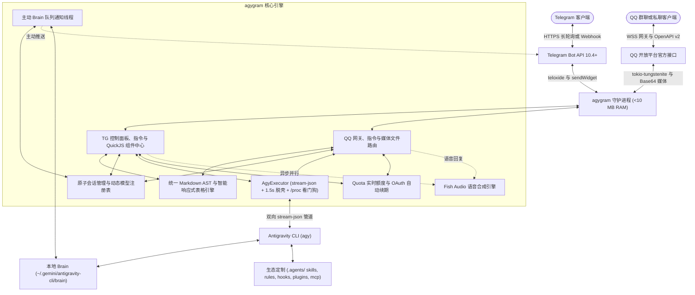

<div align="center">

# 🚀 agygram

**仅占 <10 MB 内存的纯 Rust 2024 守护进程 —— 将 Telegram 与 QQ 打造成 Google Antigravity CLI (`agy`) 的 24 小时随身移动指挥中心。**

[](https://github.com/d3intran/agygram/actions/workflows/release.yml)
[](https://github.com/d3intran/agygram/releases)
[-orange.svg?style=flat-square&logo=rust)](https://www.rust-lang.org)
[](#)
[](#)
[](#)
[](#)
[](https://opensource.org/licenses/MIT)

[English](README.md) • [简体中文](README_ZH.md) • [更新日志](CHANGELOG.md)

</div>

---

## 💡 为什么选择 agygram？

在云主机（VPS）上部署自主 AI Coding Agent 时，常见两大痛点：**API 按量账单高昂**，以及 **Node.js / Docker 方案臃肿**（1 GB 以内小内存主机极易 OOM 崩溃）。

**Google Antigravity CLI (`agy`)** 提供 **Gemini 4 Hydrogen / Carbon / Argon**、**Gemini 3.8 Flash**、**Orchestrator**、**Claude Opus/Sonnet 4.6** 与 **GPT-OSS 120B** 等前沿模型配额及 `.agents/` 生态（Skills / Rules / Hooks / Plugins / MCP）。**`agygram`** 以纯 Rust 打造零臃肿的双端守护进程：

- 🪶 **小内存小鸡原生之选（<10 MB 常驻内存）**：Fat LTO 编译单二进制仅 ~10 MB，空闲常驻内存不足 10 MB。无需 Docker 或 Node.js，在 512 MB–1 GB 云主机上即可 7×24 小时稳定运行。
- ⚡ **1.5 秒 `stream-json` 后台任务自动脱壳**：通过行缓冲管道实时驱动 `agy --output-format stream-json`。当主回复完成（`state: DONE, step_type: agent_response`）且无挂起工具调用，但子代理或 `schedule` 定时器仍在后台运行时，`agygram` 仅等待 1.5 秒宽限窗即交付首轮结果并释放会话锁，后续阶段异步流式补发，彻底告别 `child.wait()` 死锁。
- 🌐 **Telegram + QQ 官方机器人双栈并行**：单进程同时驱动 Telegram（支持 Long-Polling 长轮询与 Axum Webhook）与 QQ 开放平台官方机器人（`wss` WebSocket 网关 + OpenAPI v2），共享会话状态与本地工作区。
- 📐 **统一 Markdown AST 与移动端响应式智能表格**：基于 `pulldown-cmark` + `unicode-width` 打造统一解析引擎。窄表（`<= 38` 显示列且单行单元格）自动按东亚宽字符对齐输出 Unicode 框线表（`┌─┬─┐`）；宽表或多行内容自动切换为手机友好的竖排卡片视图，彻底解决 Telegram / QQ 手机端表格乱行问题。
- 🎛️ **重构级 Telegram 多页控制面板 & 实时模型同步**：`/panel`（`/settings`、`/status`）提供原地刷新的多级交互面板，支持模型家族→档位两级选择、实时 `agy models` + `/quota` 额度联动，以及严格 `<= 64` 字节的确定性 `callback_data` 编码。
- 🎮 **Telegram Bot API 10.4+ QuickJS 交互卡片与离线小游戏**：`/card`（`/widget`）内置 4 款零依赖离线 QuickJS 小游戏（**2048**、**扫雷**、**记忆翻牌**、**极速反应**），支持 AI 生成自定义离线小游戏（`tg-widget`）与多模板结构化卡片（`tg-card`），并在群聊或超限时无缝降级为可玩 `.html` 附件或富文本卡片。
- 📦 **QQ Base64 直传与群文件智能降级**：支持通过 QQ OpenAPI v2 `file_data`（Base64，`<= 5 MB`）免图床直传图片/MP4 视频/语音/文件（`file_type=1/2/3/4`），并在超过 5 MB 或遭平台接口限制时自动转为结构化代码/文本内联预览与服务器路径提示，绝不静默丢文件。
- 🔊 **Fish Audio 自定义语音回复**：可选异步并行语音合成（`s2.1-pro-free`），支持会话级音色热切换（`/voice id`）、QQ 情感标签（`[calm]`/`[happy]`）以及表格框线/代码块/链接过滤。

---

## 📱 Telegram 控制面板与 QuickJS 组件预览

```text
┌──────────────────────────────────────────────┐  ┌──────────────────────────────────────────────┐
│ 🎛 agygram 控制中心 v1.6.0 · agy v1.5.10     │  │ 🎮 QuickJS 交互卡片 & 离线小游戏 (/card)     │
│                                              │  │                                              │
│ • 模型: Gemini 4 Hydrogen (XHigh)            │  │ • 私聊 <= 4KB (zlib-9): 原生 sendWidget 气泡  │
│ • 力度 / 模式: xhigh · accept-edits          │  │ • 群聊 / 超限: 自动降级为可玩 .html 附件/卡片  │
│ • 实时额度: Gemini 100% · Claude/GPT 95%     │  │ • AI 生成: /card 写一个五子棋 / 复利计算器     │
│ • 会话: 8de907d6 · 4 轮 (12k in / 3.4k out)  │  │                                              │
│                                              │  │ [ 🔢 2048 ]           [ 💣 扫雷 ]            │
│ [ 🤖 模型 · H2·XHigh ]  [ 📊 实时额度 ]      │  │ [ 🃏 记忆翻牌 ]       [ ⚡ 极速反应 ]        │
│ [ ⚡ 力度: xhigh ]      [ 🎯 模式: accept ]  │  │ [ 📊 运行看板卡 ]     [ ❓ QuickJS 速测 ]    │
│ [ 💬 会话管理 ]         [ 📂 工作区 & 角色 ] │  │ [ 📋 通道对比表 ]     [ 🃏 Agent 演示卡 ]    │
│ [ 🔇 输出/TTS (关) ]    [ 🔄 刷新面板 ]      │  │ [ 🩺 当前会话状态卡 ] [ « 返回控制中心 ]     │
│ [ 🩺 系统与生态 ]       [ 🆕 开启全新会话 ]  │  └──────────────────────────────────────────────┘
└──────────────────────────────────────────────┘
```

---

## ⚡ 30 秒极速部署（预编译二进制，免本地编译）

> [!TIP]
> **切勿在 1 GB 以下小内存 VPS 上本地执行 `cargo build`**（Fat LTO 链接峰值需 1.5 GB+ 内存，极易触发 OOM）。请直接使用 GitHub Actions 云端预编译二进制。

### 第一步：确认已安装并登录 `agy` CLI
```bash
agy --version
agy models
```

### 第二步：一键下载安装并运行配置向导
```bash
# 1. 下载最新预编译二进制并自动校验 SHA-256
bash <(curl -fsSL https://raw.githubusercontent.com/d3intran/agygram/main/update.sh)

# 2. 运行交互式初始化向导（自动生成权限为 0600 的 ~/.config/agygram/config.toml）
~/agygram init

# 3. 检查配置、白名单与 agy 环境是否就绪
~/agygram check
```
*（也可手动复制 [`config.example.toml`](config.example.toml) 至 `~/.config/agygram/config.toml` 并执行 `chmod 600 ~/.config/agygram/config.toml`。）*

### 第三步：配置 Systemd 7×24 小时守护进程
```bash
sudo tee /etc/systemd/system/agygram.service > /dev/null <<EOF
[Unit]
Description=agygram Telegram & QQ Bot Daemon
After=network.target network-online.target
Wants=network-online.target

[Service]
Type=simple
User=$(whoami)
WorkingDirectory=$HOME
ExecStart=$HOME/agygram daemon
Restart=always
RestartSec=5s
Environment=PATH=/usr/local/bin:/usr/bin:/bin:$HOME/.local/bin:$HOME/.cargo/bin
Environment=HOME=$HOME

[Install]
WantedBy=multi-user.target
EOF

sudo systemctl daemon-reload
sudo systemctl enable --now agygram
sudo systemctl status agygram --no-pager
```

### 🔄 一键平滑升级（支持指定版本）
```bash
# 升级至最新版（自动校验 SHA-256、保留最近 3 份备份、自动重启 systemd 服务）
bash <(curl -fsSL https://raw.githubusercontent.com/d3intran/agygram/main/update.sh)

# 可选：安装或回滚到指定版本 Tag
AGYGRAM_VERSION=v1.6.2 bash <(curl -fsSL https://raw.githubusercontent.com/d3intran/agygram/main/update.sh)
```

---

## ✨ v1.6.x 核心特性矩阵

| 模块 | 核心能力说明 |
| :--- | :--- |
| 🧠 **统一 Markdown AST 与智能表格** | 基于 `pulldown-cmark` + `unicode-width` 统一解析。`<= 38` 显示列且单行单元格渲染为 CJK 对齐 Unicode 框线表；宽表或多行表自动转换为竖排卡片，手机端绝不乱行。分块切割器支持标签/代码块围栏跨块自动闭合重开，并在 Telegram HTML 解析异常时优雅降级纯文本。 |
| 🎛️ **Telegram 多级控制面板** | `/panel`（`/settings`、`/status`）与 `/session` 支持两级模型家族/变体选择、实时 `agy models` 合并、`/quota` 剩余额度徽章、思考力度/执行模式/工作区/沙盒/Agent/TTS 一键控制，所有按钮 `callback_data` 严格控制在 `<= 64` 字节。 |
| 🎮 **QuickJS 交互卡片与离线小游戏** | 适配 Telegram Bot API 10.4+ `sendWidget`（`<= 32 KB` 原始 / `<= 4,096 B` zlib-9 压缩校验）。内置 **2048**、**扫雷**、**记忆翻牌**、**极速反应** 4 款离线游戏及多模板 `tg-card` JSON、AI 生成 `tg-widget` 应用，群聊或超限时自动降级为可玩 `.html` 附件或富文本卡片。 |
| 🐧 **QQ 官方机器人与媒体直传** | 内置腾讯 QQ 开放平台 WSS 网关与 OpenAPI v2 客户端，支持 `file_type=1/2/3/4` 通过 `file_data` Base64 免外链直传（`<= 5 MB`，实测支持 QQ 群发送 `.md` 等文档），采用「仅显式请求才发产物」规范（`[[send_file:...]]` + `/file <路径>`），支持 `/model <序号>`、`/compact` 及超限预览降级。 |
| ⚡ **1.5s 异步脱壳与进程树看门狗** | 实时解析 `agy --output-format stream-json`。主轮次结束且无活跃工具时，1.5s 内自动脱壳释放会话锁并在后台继续接收多阶段回复；看门狗结合 `/proc` 进程树 CPU/IO 活跃度判定真假卡死（`idle_timeout_secs` + `max_execution_secs`）。 |
| 🔔 **主动通知推送与生态集成** | 监听 `~/.gemini/antigravity-cli/brain` 主动推送定时任务（`schedule`）与后台结果；内置 `/skills`、`/rules`（`GEMINI.md` / `AGENTS.md` / `.agents/rules/*.md`）、`/mcp`、`/plugin`、`/plan`、`/walkthrough`、`/changelog`、`/update`。 |
| 🔊 **Fish Audio AI 语音回复** | 可选接入 Fish Audio（`s2.1-pro-free`），支持会话级 `/voice id` 切换音色、QQ 情感标签与表格/代码/链接清洗。 |

---

## 🏗️ 系统架构拓扑



---

## 🤖 支持模型矩阵与 CLI 参数对齐

`agygram` 内置最新 `agy` 模型目录，并在运行时**自动拉取合并 `agy models` 新增模型**（120 秒 TTL 缓存 + `/quota` 未映射模型自动触发刷新）：

| 模型家族 | 官方 CLI 模型 ID | 思考力度 (`--effort`) 规则 | 常用别名 |
| :--- | :--- | :--- | :--- |
| 💎 **Gemini 4 Hydrogen** | `gemini-4-hydrogen-{xhigh,high,medium,low}` | 已固化于型号后缀 | `h2`, `hydrogen`, `h2-xhigh` |
| 🔷 **Gemini 4 Carbon** | `gemini-4-carbon-{high,medium,low}` | CLI 默认家族（支持 `low`/`medium`/`high`） | `carbon`, `carbon-high`, `default` |
| 🔹 **Gemini 4 Argon** | `gemini-4-argon-{high,medium,low}` | 已固化于型号后缀 | `argon`, `gemini-4`, `4-high` |
| ⚡ **Gemini 3.8 Flash** | `gemini-3.8-flash-{high,medium,low}` | 已固化于型号后缀 | `flash`, `3.8`, `3.8-high` |
| 🧠 **Orchestrator** | `gemini-pro-orchestrator`, `gemini-pro-orchestrator-argon` | 模型固定预算 | `orch`, `orch-argon` |
| 👑 **Claude 4.6** | `claude-opus-4-6-thinking`, `claude-sonnet-4-6` | 模型固定预算 | `opus`, `sonnet`, `claude` |
| 🌐 **GPT-OSS** | `gpt-oss-120b-medium` | 模型固定预算 | `oss`, `gpt`, `120b` |

> [!NOTE]
> 对内置固定预算或自带档位后缀的模型（`claude-*`、`gemini-pro-orchestrator*`、`gpt-oss-*`、`*-{low,medium,high,xhigh}`），`agygram` 会自动省略冲突的 `--effort` 参数，并在默认模型 `gemini-4-carbon` 上自动将 `xhigh`/`max` 对齐为 `high`，彻底避免 CLI 报错。

---

## 📋 指令速查手册

### 📱 Telegram 端指令
| 分类 | 指令 | 说明 |
| :--- | :--- | :--- |
| **控制与会话** | `/panel`, `/settings`, `/status` | 打开多级交互式控制中心 |
| | `/session` | 打开会话管理中心（Token 统计、历史切换、`/plan`、`/walkthrough`） |
| | `/new`, `/reset`, `/clear` | 开启新会话并重置上下文与统计计数 |
| | `/resume [<ID>]` | 接续指定会话 ID 或从最近列表点击恢复（留空支持 `-c`） |
| | `/history` | 浏览 VPS 最近活跃会话并一键接续 |
| | `/quota`, `/usage` | 查看实时 Gemini 与 Claude/GPT 额度进度条与重置倒计时 |
| | `/cancel` | 中断正在执行的任务（`SIGINT` -> `SIGKILL`）并释放锁 |
| **卡片与游戏** | `/card`, `/widget` | 打开 QuickJS 交互卡片与离线小游戏中心（`2048` / `扫雷` / `记忆翻牌` / `极速反应`） |
| | `/card <游戏\|demo\|html <目标>\|<需求>` | 直玩游戏、导出独立 `.html` 附件，或让 AI 现场生成自定义互动卡片/小游戏 |
| **模型与参数** | `/model [<ID\|序号\|别名>]` | 打开模型家族选择器或直接切换（支持动态新模型） |
| | `/models` | 实时同步 `agy models` 并按家族分组编号展示 |
| | `/effort [<级别>]` | 设置思考力度（`low`/`medium`/`high`/`xhigh`/`max`），自动同步同家族后缀变体 |
| | `/mode [<模式>]` | 切换执行模式（`accept-edits` / `auto` / `plan`） |
| | `/agent [<名称>]`, `/agents` | 切换或列出可用 Antigravity Subagent |
| | `/sandbox [on\|off\|toggle]` | 开关 `agy --sandbox` 沙盒隔离 |
| | `/project [<名称>\|clear]` | 绑定或清空 `agy --project` 工程 |
| | `/system [<提示词>\|clear]` | 查看、设置或清空自定义 System Prompt |
| | `/voice [on\|off\|toggle\|id <ID>\|<问题>]` | 开关常驻语音、切换 Fish Audio 音色或单次语音提问 |
| **目录与生态** | `/cd <路径>`, `/pwd`, `/dirs` | 切换主工作目录（支持 `~/...`）或查看已绑定目录 |
| | `/adddir <路径>`, `/cleardirs` | 添加或清空附加项目目录（`--add-dir`） |
| | `/file <路径>` | 从 VPS 下载指定文件（<= 50 MB）到 Telegram |
| | `/plan`, `/walkthrough` | 查看当前会话的 `implementation_plan.md` 或 `walkthrough.md` |
| | `/skills`, `/rules` | 查看已加载的技能库与 `GEMINI.md` / `AGENTS.md` / `.agents/rules/*.md` 规则 |
| | `/mcp [<子命令>]`, `/plugin [<子命令>]`, `/plugins` | 管理或查看 `agy mcp` 与 `agy plugin` 生态 |
| | `/changelog`, `/update` | 查看 `agy changelog` 或一键执行 `agy update` |

### 🐧 QQ 端指令（支持群内 `@机器人` 与私聊）
- **控制与会话**：`/start`, `/help`, `/panel`, `/status`, `/new`, `/reset`, `/clear`, `/compact [<侧重点>]`, `/resume [<ID>]`, `/history`, `/quota`, `/usage`, `/cancel`
- **模型与参数**：`/models`, `/model [<序号|ID|别名|reset>]`（如 `/model 1`、`/model argon`）, `/effort [<级别>]`, `/mode [<模式>]`, `/agent [<名称|reset>]`, `/agents`, `/sandbox [on|off|toggle]`, `/project [<名称|clear>]`, `/system [<提示词>|clear]`
- **工作区、文件与生态**：`/workspace [<路径>]`, `/cd <路径>`, `/pwd`, `/dirs`, `/adddir <路径>`, `/cleardirs`, `/file <路径>`, `/skills`, `/rules`, `/voice [on|off|toggle|id <ID>|<问题>]`

### 💻 终端命令行 (`agygram`)
```text
agygram daemon   # 启动 Telegram / QQ / 双栈守护进程（无子命令时默认执行）
agygram init     # 运行交互式初始化向导（以 0600 权限生成 ~/.config/agygram/config.toml）
agygram config   # 查看当前生效的配置文件路径与内容
agygram check    # 校验配置、白名单、agy CLI 路径与内置模型目录
agygram quota    # 在终端直接查询并打印 Antigravity 实时额度面板
```

---

## 🛠️ 从源码编译（开发者 / 高配编译机）

<details>
<summary><b>点击展开源码编译步骤（需 Rust 1.88+ / Edition 2024 及 >= 1.5 GB 可用内存）</b></summary>

```bash
curl --proto '=https' --tlsv1.2 -sSf https://sh.rustup.rs | sh
git clone https://github.com/d3intran/agygram.git
cd agygram
cargo build --release
./run.sh --version
```
</details>

---

## ❓ 常见问题排查 (FAQ)

<details>
<summary><b>Q1: 为什么不要在 1 GB 小内存 VPS 上执行 <code>cargo build</code>？如何安全升级？</b></summary>
<p><code>agygram</code> 启用了 <code>lto = "fat"</code> 与 <code>codegen-units = 1</code> 以换取 ~10 MB 极小体积与 &lt;10 MB 运行内存，因此编译链接阶段峰值内存需 1.5 GB 以上，在小鸡上本地编译会卡死甚至触发 OOM。标准流程是推送代码到 GitHub，由 GitHub Actions（<code>.github/workflows/release.yml</code>）自动运行 <code>cargo fmt</code>、<code>clippy -D warnings</code>、<code>cargo test</code> 并构建发布产物，然后在 VPS 上执行 <code>update.sh</code> 完成 SHA-256 校验替换与重启。</p>
<p><b>Systemd 提示：</b>如果你是在 <code>agygram</code> 拉起的 <code>agy</code> 会话内执行重启操作，请注意服务单元的 <code>KillMode</code> 设置——默认 <code>KillMode=control-group</code> 会连带清理 cgroup 内的子进程，而 <code>KillMode=process</code> 则只重启主守护进程。</p>
</details>

<details>
<summary><b>Q2: QQ 机器人到底支不支持发送文件到群里？(<code>file_type=4</code> 机制说明)</b></summary>
<ul>
  <li><b>历史文档 vs. 最新官方接口：</b>早期 QQ OpenAPI v2 文档曾长期将 <code>file_type=4</code>（普通文件）标注为「暂未支持」，且 <code>agygram</code> 早期版本仅接入了图片（<code>1</code>）和语音（<code>3</code>）。根据腾讯最新 OpenAPI v2 官方文档（<code>v1.50.0</code>），群接口 <code>POST /v2/groups/{group_openid}/files</code> 与单聊接口 <code>POST /v2/users/{user_openid}/files</code> 均已文档化支持 <code>file_type=1</code>（图片）、<code>2</code>（MP4 视频）、<code>3</code>（语音）、<code>4</code>（文件），并支持直接通过 <code>file_data</code>（Base64）上传 <b>5 MB 以内</b> 的本地文件，无需额外搭建公网图床/文件服务器。</li>
  <li><b>现实约束：</b>实际运行时仍可能受机器人权限等级、文件格式校验（如错误码 <code>850019</code>、<code>10000</code>、<code>40093002</code>）或被动回复窗口限制（群聊 <code>msg_id</code> 5 分钟内最多 5 次、私聊 60 分钟内最多 4 次，错误码 <code>40034128</code>）。</li>
  <li><b>agygram v1.6+ 的智能处理：</b>默认不因文本提及路径而自动发群文件；仅在用户明确要求发送文件或触发 <code>[[send_file:...]]</code> / <code>/file</code> 时，程序会优先使用 <code>file_data</code> Base64 直传（<code>&lt;= 5 MB</code>，已实测验证 QQ 群可直传 <code>.md</code> 等文档），遇到 <code>40034128</code> 自动回退主动消息接口。若文件超过 5 MB 或被 QQ 接口拒收，<code>agygram</code> <b>绝不静默失败</b>：对可预览文本（<code>&lt;= 64 KB</code>）自动转为 <code>QqFormatter</code> 格式化文本预览分块发送，对大型或二进制文件明确反馈原因与服务器精确路径。</li>
</ul>
</details>

<details>
<summary><b>Q3: Telegram QuickJS Widget (<code>/card</code>) 在群聊或不支持的客户端中会怎样？</b></summary>
<p>Telegram Bot API 10.4+ 规定 <code>sendWidget</code> 仅限<b>私聊</b>（<code>chat_id &gt; 0</code>），且要求原始 HTML <code>&lt;= 32 KB</code>、zlib-9 压缩后 <code>&lt;= 4,096 B</code>。<code>agygram</code> 会自动完成压缩校验与离线沙盒检查：若处于群聊、负载压缩超过 4 KB 或收到客户端不支持错误，小游戏与交互应用会自动降级发送独立的 <code>.html</code> 文件（可在 Telegram 内置浏览器直接运行游玩），信息卡片则自动降级为排版精美的 Telegram HTML 摘要消息。</p>
</details>

<details>
<summary><b>Q4: 机器人提示未授权或无响应？</b></summary>
<p>由于 <code>agygram</code> 以 <code>--dangerously-skip-permissions</code> 驱动 <code>agy</code>，默认采用<b>严格白名单（Fail-Closed）</b>策略。请向 Telegram <code>@userinfobot</code> 查询你的纯数字 User ID 填入 <code>allowed_user_ids</code>，或将 QQ 用户/群 OpenID 填入 <code>qq_allowed_openids</code> / <code>qq_allowed_groups</code> 后重启服务。</p>
</details>

<details>
<summary><b>Q5: 如何配置代理、Webhook 或 Fish Audio 自定义语音？</b></summary>
<p>编辑 <code>~/.config/agygram/config.toml</code>（完整字段说明见 <a href="config.example.toml">config.example.toml</a>）：</p>
<ul>
  <li><b>代理设置：</b>配置 <code>proxy_url = "socks5://127.0.0.1:1080"</code> 或 <code>"http://127.0.0.1:7890"</code>（未设置时自动读取 <code>HTTPS_PROXY</code> / <code>HTTP_PROXY</code>）。</li>
  <li><b>Webhook 模式：</b>设置 <code>webhook_url</code>、<code>webhook_port</code>（默认 <code>8443</code>）和 <code>webhook_secret</code> 即可切换为 Axum Webhook 接收模式。</li>
  <li><b>Fish Audio 语音：</b>填写 <code>fish_api_key</code> 与可选的 <code>fish_reference_id</code>，在聊天中发送 <code>/voice on</code> 开启或 <code>/voice id &lt;音色ID&gt;</code> 动态换声。</li>
</ul>
</details>

---

## 📜 开源协议

本项目基于 [MIT License](https://opensource.org/licenses/MIT) 开源。
